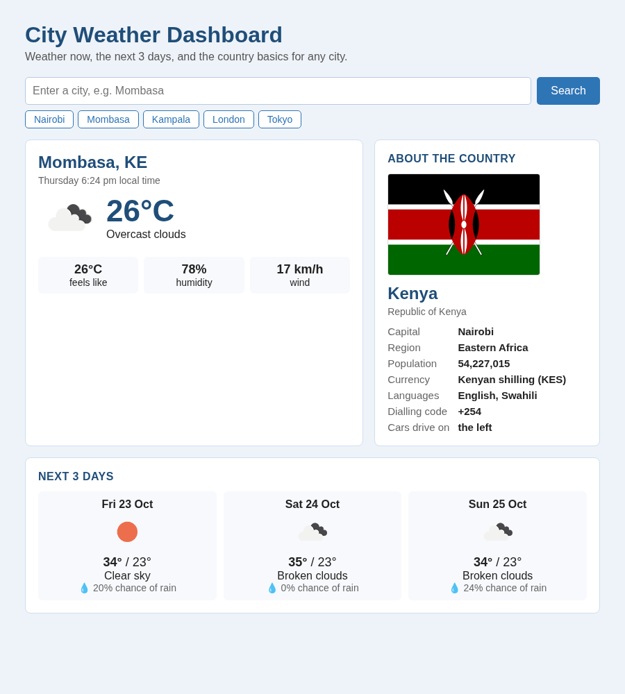

# City Weather Dashboard

A single web page where you type any city and see the weather right now, a 3-day forecast, and the country's basic facts (capital, population, currency, languages, flag) on one dashboard.

**Version 1.0, client delivery.** Built in Week 1 · Day 5 ([original](../../../Week1_APIS/Day5/weather_dashboard/)) and packaged for delivery in Week 2 · Day 8. See [CHANGELOG.md](CHANGELOG.md) for what changed.



## The problem it solves

Before a trip or a business visit you usually check a weather site, then a forecast, then look the country up somewhere else. This dashboard puts all of that on one screen from a single search.

## How it works

Three live API calls, chained from one city name:

```
City name ("Mombasa")
  └─> 1. OpenWeatherMap current weather ──> temperature, sky, wind... AND country code "KE" + coordinates
        ├─> 2. OpenWeatherMap 5-day forecast (by coordinates) ──> 40 readings, summarised into 3 days
        └─> 3. REST Countries v5 (by country code) ──> capital, population, currency, languages, flag
```

Calls 2 and 3 don't depend on each other, so they run at the same time with `Promise.all`.

## Setup

1. Clone the repo and go into this folder:
   ```bash
   cd Week2_ClientCycles/Day8/weather_dashboard
   ```
2. Get two free API keys:

   | API | Sign up | Notes |
   |---|---|---|
   | OpenWeatherMap | [openweathermap.org](https://openweathermap.org) | New keys can take up to 2 hours to activate |
   | REST Countries | [restcountries.com/sign-up](https://restcountries.com/sign-up) | In the key's settings, add **`localhost`** to the allowed origins (CORS). Without it the API blocks requests from web pages |

3. Copy `config.example.js` to `config.js` and paste your keys:
   ```js
   window.APP_CONFIG = {
     OPENWEATHER_API_KEY: "your_openweathermap_key",
     RESTCOUNTRIES_API_KEY: "your_restcountries_key",
   };
   ```
   `config.js` is in `.gitignore`, so your keys never reach GitHub.

## Usage

Start a small local web server in this folder (Python has one built in):

```bash
python3 -m http.server 8000
```

Then open **http://localhost:8000** in your browser, type a city and press **Search** (or Enter), or click one of the quick-pick cities. Press `Ctrl+C` in the terminal to stop the server when you're done.

> **Why a server, not just double-clicking?** A file opened straight from your disk has no web address, so REST Countries can't check it against the allowed origins and refuses it. The weather still works if you double-click `index.html`; the country card will show a note telling you to use the server.

## The three states

| State | What you see |
|---|---|
| **Loading** | `Loading the dashboard for Mombasa...`, and the Search button greys out so it can't be double-clicked |
| **Success** | Weather card, country card and 3-day forecast |
| **Error** | A red box explaining what went wrong in plain English |

## How it handles problems

| Situation | What you see |
|---|---|
| Empty search box | `Please enter a city name first.` |
| City doesn't exist (404) | `No city called "Xyzqwe" was found. Check the spelling and try again.` |
| Wrong / inactive OpenWeatherMap key (401) | `The OpenWeatherMap key in config.js is wrong or not active yet...` |
| `config.js` missing | `No OpenWeatherMap key found. Copy config.example.js to config.js...` |
| Too many requests (429) / server down (500+) | A message saying to wait or try later |
| No internet | `Couldn't reach the weather service. Check your internet connection.` |
| REST Countries key doesn't allow this site | Weather still shows; the country card explains how to add `localhost` |
| Page opened by double-clicking | Weather still shows; the country card says to use the local server |

A country problem never breaks the page: the weather is the main thing, so the country card just shows a yellow note instead.

## Assumptions

- **Runs on your own computer.** It isn't hosted online. You open it through the local server described above.
- **Metric units.** Temperatures are in °C and wind is in km/h.
- **Free API plans are enough.** OpenWeatherMap's free plan allows 1,000 calls a day and each search uses 2, so that's about 500 searches a day. REST Countries' free plan covers the third call.
- **"3-day forecast" means the next three full days.** Today is already covered by the current-weather card.
- **The first match wins.** If two places share a name (for example London, UK and London, Canada), OpenWeatherMap picks the best-known one. Add the country code to choose: `London,CA`.
- **Times are the city's local time,** not the time on your computer.

## A note on API keys in the browser

Anything a web page uses can be seen by anyone who opens it (View Page Source / DevTools). That's why the keys sit in `config.js`, which never goes to GitHub, instead of in `index.html`. This is fine for a page you run on your own computer. If this were put online for other people, the keys would move to a small backend server that calls the APIs for the page (covered on Day 16).

## Files

| File | What it is |
|---|---|
| `index.html` | The whole dashboard: HTML, CSS and JavaScript |
| `config.example.js` | Template for your API keys |
| `config.js` | Your real keys (you create it; never committed) |
| `.gitignore` | Keeps `config.js` out of git |
| `screenshot.png` | The screenshot above |
| `CHANGELOG.md` | What changed for the v1.0 delivery |
| `README.md` | This guide |

## What I practised

- `fetch()` with `async`/`await` and `try`/`catch`
- Chaining API calls: the first answer gives the inputs (country code, coordinates) for the next two
- Running independent requests in parallel with `Promise.all`
- Turning 40 three-hourly readings into a clean 3-day summary (group by local day, min/max, most common)
- Working with time zones using the offset the API sends
- Handling CORS and allowed origins for a keyed API
- Keeping keys out of git, and escaping text before putting it in `innerHTML`
