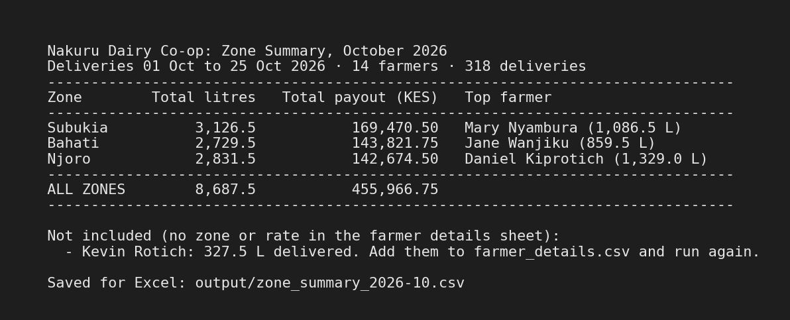

# Day 11: Advanced pandas: Dairy Co-op Zone Summary

*Week 3 · Advanced Data Analysis · Merge, pivot, apply and groupby on a real-looking client problem.*

A Nakuru dairy co-op manager keeps two spreadsheets: one for daily milk collection, one for farmer details. This script combines them into **one table per zone for the month**: total litres, total payout and the top farmer. You can screenshot it and send it straight to the client.



## The brief

> A Nakuru dairy co-op manager has two spreadsheets. One records daily milk collection per farmer (farmer name, date, litres). The other holds farmer details (farmer name, zone, payment rate per litre). He wants one table showing: total litres per zone this month, total payout per zone, and top farmer per zone.

## The two input files

Both are CSV files, which is what Excel gives you with **File → Save As → CSV**. The script looks for them in `data/`.

**1. `data/milk_collection.csv`**: one row per farmer per delivery

| Column | Example | Notes |
|---|---|---|
| `farmer_name` | `Peter Kamau` | Capitals and extra spaces don't matter (`jane wanjiku ` is matched to `Jane Wanjiku`) |
| `date` | `2026-10-01` | Year-month-day |
| `litres` | `18.5` | Litres delivered that day |

**2. `data/farmer_details.csv`**: one row per farmer

| Column | Example | Notes |
|---|---|---|
| `farmer_name` | `Jane Wanjiku` | Each farmer once only |
| `zone` | `Bahati` | The collection zone |
| `rate_kes_per_litre` | `52.0` | What the co-op pays this farmer per litre |

## Setup and usage

```bash
cd Week3_AdvancedDataAnalysis/Day11
pip install pandas

python zone_summary.py                                         # uses the two files in data/
python zone_summary.py my_collection.csv my_farmer_details.csv # or point it at other files
```

The table prints on screen, and the same numbers are saved to `output/zone_summary_2026-10.csv` (named after the month), which opens in Excel.

## What the script does, step by step

| Step | pandas used | Why |
|---|---|---|
| 1. Load both CSVs and check the columns are there | `read_csv` | A missing column gives a clear message, not a `KeyError` |
| 2. Tidy the names in both files | `.apply(clean_name)` | The merge matches names **exactly**. `LUCY WAMBUI` and `Lucy Wambui` would otherwise be two different farmers |
| 3. Keep only this month | `to_datetime`, `.dt.to_period("M")` | "This month" = the latest month in the collection sheet |
| 4. Merge deliveries with farmer details | `pd.merge(..., on="farmer_name", how="left", validate="many_to_one", indicator=True)` | Adds each delivery's zone and rate |
| 5. Work out each delivery's payout | `litres * rate_kes_per_litre` | Each farmer's own rate, so zone totals are right even when rates differ inside a zone |
| 6. Total litres and payout per zone | `pd.pivot_table(index="zone", aggfunc="sum")` | The pivot by zone |
| 7. Top farmer per zone | `groupby(["zone", "farmer_name"]).sum()` then `groupby("zone").idxmax()` | The farmer with the most litres in each zone |
| 8. Build the "Top farmer" label | `.apply(..., axis=1)` | Row-by-row text: `Mary Nyambura (1,086.5 L)` |
| 9. Print and save | f-strings, `to_csv` | A clean table for the screenshot, and a CSV for Excel |

## Choosing the join type (Step 2 of the lesson, in practice)

The lesson's example used an **inner** join. Here that would be a quiet mistake. Kevin Rotich delivered 327.5 L this month but isn't in the farmer details sheet yet. An inner join would drop his milk without a word, and the manager would never know he'd been missed.

So the script uses a **left** join (keep every delivery) with `indicator=True`, which marks each row as matched (`both`) or not (`left_only`). Matched rows go into the summary. Unmatched farmers are listed under the table with their litres, so the manager can add them and run it again:

```
  Not included (no zone or rate in the farmer details sheet):
    - Kevin Rotich: 327.5 L delivered. Add them to farmer_details.csv and run again.
```

`validate="many_to_one"` is the other safety check: many deliveries per farmer, but only **one** row per farmer in the details sheet. If a farmer were listed twice, every one of their deliveries would be counted twice. The script checks for this first and stops with the farmer's name.

## Reading the result

```
  Zone        Total litres   Total payout (KES)   Top farmer
  Subukia          3,126.5           169,470.50   Mary Nyambura (1,086.5 L)
  Bahati           2,729.5           143,821.75   Jane Wanjiku (859.5 L)
  Njoro            2,831.5           142,674.50   Daniel Kiprotich (1,329.0 L)
  ALL ZONES        8,687.5           455,966.75
```

- **Njoro supplied more milk than Bahati but costs less.** Its rate is lower (KES 50–51.50 against 52–53.50). That's why the table is sorted by payout, not litres: the manager is planning cash.
- **Daniel Kiprotich alone is 47% of Njoro's milk** (1,329 of 2,831.5 L). If he has a bad month, the whole zone does.
- The October figures cover 1 to 25 October. The date line at the top says so, so nobody mistakes them for a full month.

## Checking the numbers

I recalculated the totals separately, with a few lines of plain pandas outside the script. Zone litres, payouts and top farmers all matched exactly. Every row is accounted for: 318 matched deliveries + 24 of Kevin's = all 342 rows in the file.

## When the files have problems

| Problem | What you see |
|---|---|
| A file is missing | `Can't build the summary. Can't find nope.csv.` |
| A column is missing | `farmer_details.csv is missing the column(s): rate_kes_per_litre. Expected: farmer_name, zone, rate_kes_per_litre.` |
| A farmer is listed twice in the details | `These farmers appear more than once in farmer_details.csv: Peter Kamau. Each farmer should have one row.` |
| A date that isn't real (`32/10/2026`) | `1 row(s) in milk_collection.csv have a date that isn't a real date. Use the format 2026-10-25.` |
| A farmer delivered but isn't in the details | The summary still prints. They're listed under it with their litres |

## The sample data

There's no real co-op data, so `generate_sample_data.py` creates it: **14 farmers in 3 real Nakuru County areas (Bahati, Njoro, Subukia)**, with deliveries from 1 to 25 October 2026. Each farmer has their own usual yield (9 to 55 L a day) and their own rate. It's random, with a fixed seed, so it gives the same files every time. I put in the kind of mess real client spreadsheets have:
- names typed differently (`jane wanjiku `, `Daniel  Kiprotich`, `LUCY WAMBUI`);
- missed delivery days;
- a new farmer who isn't in the details sheet yet.

```bash
python generate_sample_data.py   # rewrites data/milk_collection.csv and data/farmer_details.csv
```

## Files

| File | What it is |
|---|---|
| `zone_summary.py` | The script |
| `data/milk_collection.csv` | Input 1: daily collections (342 rows) |
| `data/farmer_details.csv` | Input 2: farmer, zone, rate (14 farmers) |
| `generate_sample_data.py` | Makes the sample data above |
| `output/zone_summary_2026-10.csv` | The summary, ready for Excel. Created each time you run the script (not stored in the repo) |
| `screenshot.png` | The output as you'd send it to the client |
| `README.md` | This guide |

## What I practised

- `pd.merge` with `on`, `how`, `validate` and `indicator`, and choosing **left** over **inner** for a business reason
- `pd.pivot_table` to total by zone
- `groupby` + `idxmax` to find the top row inside each group
- `.apply()` on a column (cleaning names) and across rows (`axis=1`, building labels)
- Cleaning join keys before a merge. The merge is only as good as the column you merge on
