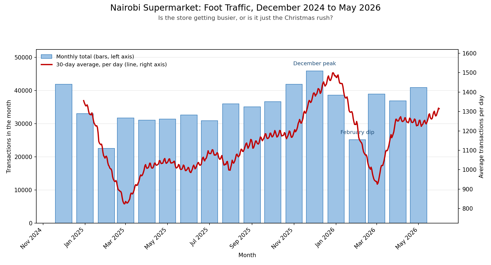

# Day 12: Time Series Analysis: Supermarket Foot Traffic

*Week 3 · Advanced Data Analysis · Dates as an index, resampling, and a rolling average on a real client question.*

A Nairobi supermarket chain has 18 months of daily transaction counts. The operations manager wants to know one thing: **are we genuinely getting busier, or is this just the Christmas rush?** This project turns the daily numbers into a monthly trend chart with a 30-day rolling average, and answers that question with figures he can take to the board.



## The brief

> A Nairobi supermarket chain wants to understand whether their foot traffic follows seasonal patterns. They have daily transaction counts for the past 18 months. The operations manager wants a chart showing the monthly trend and a 30-day rolling average so he can spot whether sales are genuinely growing or just fluctuating.

## The trend I would report

> Foot traffic is genuinely growing, not just fluctuating: the same six months (December to May) were 18% busier a year later, and December 2025 ran 10% above December 2024. The seasonal swing is just as strong, with December averaging 1,416 transactions a day against 852 in February, so staffing and stock should follow that cycle rather than the average.

## Reading the chart

- **Blue bars (left axis):** total transactions in each month.
- **Red line (right axis):** the 30-day rolling average of daily transactions. It smooths out the Saturday spikes and single promotion days, so the direction is easy to see.
- The two axes are needed because a monthly total is around 30 times a daily figure. The bars answer "how big was the month", the line answers "which way is the day-to-day business moving".
- The line starts at the end of December: a 30-day average needs 30 days of history before it can draw its first point.

The chart shows both effects at once. The bars climb from one festive season to the next, and the red line climbs with them, so the growth is not a one-off December. The line also dips every February and jumps every December, which is the seasonal pattern the manager asked about.

## The numbers behind it

| Measure | Result |
|---|---|
| Period | 1 Dec 2024 to 31 May 2026 (547 days) |
| Total transactions | 631,025 |
| Busiest month | December 2025, 45,920 transactions |
| Quietest month | February 2025, 22,542 transactions |
| Average December day | 1,416 transactions |
| Average February day | 852 transactions |
| Dec–May 2024/25 | 1,053 a day |
| Dec–May 2025/26 | 1,244 a day (**+18.1%**) |
| December 2024 vs 2025 | 1,351 to 1,481 a day (+9.7%) |
| February 2025 vs 2026 | 805 to 899 a day (+11.7%) |

Two comparisons matter more than the rest:

1. **Same six months, one year apart.** December to May appears at both ends of the data, so the seasons cancel out. The 18% difference is genuine growth, not a calendar trick.
2. **Same month, one year apart.** December grew 9.7% and February grew 11.7%. February is still the quiet month, but each February is busier than the last.

One thing to keep in mind when reading monthly bars: months have different lengths. December has 31 days and February has 28, so part of the gap between them is simply the calendar. That is why the daily average and the 30-day line are the fair comparison, and why the report quotes "a day" rather than only monthly totals.

## How to run it

```bash
cd Week3_AdvancedDataAnalysis/Day12
pip install pandas numpy matplotlib

python generate_sample_data.py   # writes data/daily_transactions.csv
python traffic_trend.py          # reads it, saves traffic_trend.png, prints the summary
```

`traffic_trend.py` also takes a different file if you have one:

```bash
python traffic_trend.py path/to/your_counts.csv
```

The CSV needs two columns: `date` (`YYYY-MM-DD`) and `transactions`.

## What the script does, step by step

| Step | pandas / matplotlib used | Why |
|---|---|---|
| 1. Load the CSV and check the columns | `read_csv`, a clear error message | A missing file or column should not end in a traceback |
| 2. Turn `date` into a real date and make it the index | `to_datetime`, `set_index` | The index is what unlocks `resample` and rolling windows |
| 3. Sort by date and drop duplicate days | `sort_values`, `drop_duplicates` | A shuffled export or a repeated day would distort the totals |
| 4. Total the daily counts by month | `.resample("MS").sum()` | `MS` = month start, so each bar is a full calendar month |
| 5. Smooth the daily counts | `.rolling(30, min_periods=30).mean()` | Shows the trend and hides the weekend noise |
| 6. Draw the bars and the line | `ax.bar`, `ax.twinx`, `ax.plot` | Two scales on one timeline |
| 7. Label for a non-technical reader | title, subtitle, axis labels, legend, `MonthLocator` | The manager should understand it without a caption |
| 8. Mark the seasons | `annotate` | "December peak" and "February dip" are the two things he will ask about |
| 9. Report the figures | `idxmax`, `idxmin`, boolean filters | The same numbers in text, for the README and the conversation |
| 10. Save the chart | `savefig(dpi=150)` | A PNG that is sharp enough to paste into a report |

## The sample data

There is no real client data, so `generate_sample_data.py` makes it with `numpy`, using a fixed seed so it is the same every run:

- 547 days, **December 2024 to May 2026**. Eighteen months is enough to hold **two** Decembers and **two** Februaries. One December alone would show a spike, not a pattern.
- A slow upward trend of about 30% across the period.
- Monthly seasonality: December ×1.38, November ×1.18, February ×0.78.
- Day-of-week effect: Saturday ×1.31, Monday ×0.90.
- Payday weeks (first five and last five days of the month) a little busier.
- Random daily noise, a small month-to-month variation, and seven promotion days with obvious spikes.

The result is messy enough to look real and clean enough that the seasonal pattern is visible, which is what the exercise is about.

## Files

| File | What it is |
|---|---|
| `generate_sample_data.py` | Makes the sample data (fixed seed, reproducible) |
| `data/daily_transactions.csv` | Input: one row per day, 547 rows |
| `traffic_trend.py` | The analysis and the chart |
| `traffic_trend.png` | The chart, committed because the brief asks for it in the repo |
| `README.md` | This guide |

## What I practised

- Making a date column the index and letting pandas work with time (`to_datetime`, `set_index`)
- `resample("MS").sum()` to move from daily rows to monthly totals
- `rolling(30).mean()` for a trend that ignores daily noise, and `min_periods` so it does not draw a misleading line from day one
- Reading a dual-axis chart honestly: bars for volume, line for direction, and a note on the different scales
- `idxmax` / `idxmin` and simple filters to pull the best month, the worst month, and same-month year-over-year comparisons
- Turning chart output into two sentences a manager can repeat in a meeting
