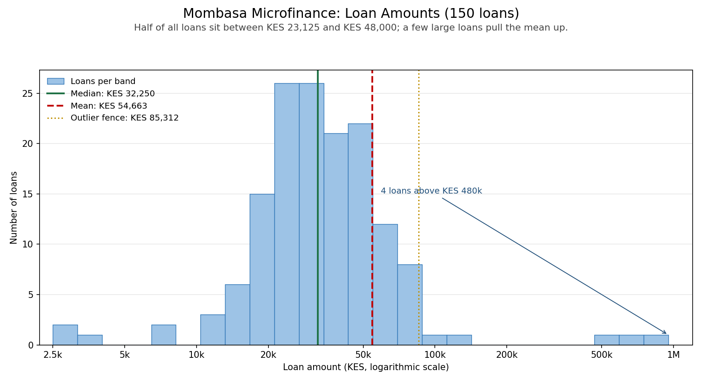

# Day 13: Statistical Analysis Basics: Mombasa Microfinance Loan Book

*Week 3 · Advanced Data Analysis · Descriptive statistics, IQR outliers, correlation, and a finding a board can act on.*

A Mombasa microfinance institution wants to understand its loan book before presenting to the board. Three questions: what is a typical loan, are there unusually large or small loans, and is there a link between loan size and how quickly the first repayment arrives? This project answers all three with numbers, a chart and a plain-language finding.



## The brief

> A microfinance institution in Mombasa wants to understand their loan repayment data before presenting to board members. They want to know: what is the typical loan amount, are there unusually large or small loans, and is there any link between loan size and days to first repayment.

## The sentence for the board

> **Larger loans tend to take somewhat longer to reach a first repayment, but loan size is only part of the story.**

That is the honest reading of the correlation: Pearson **r = 0.339** (a weak positive relationship), p < 0.0001, and **r² = 0.115**, which means loan size explains about **11%** of the variation in repayment time. The other 89% comes from things this file does not record: the borrower's business, the repayment schedule, the county, and simple luck. The link is real enough to mention, not strong enough to change lending rules on its own. And a correlation is not a cause.

## What the numbers say

| Measure | Loan amount (KES) | Days to first repayment |
|---|---:|---:|
| Count | 150 | 150 |
| Mean | 54,663 | 19.3 |
| Std deviation | 116,664 | 10.7 |
| Minimum | 2,500 | 3 |
| Q1 (25th percentile) | 23,125 | 14 |
| Median (50th percentile) | 32,250 | 17.5 |
| Q3 (75th percentile) | 48,000 | 23 |
| Maximum | 950,000 | 88 |

Three readings matter:

- **The mean is not the typical loan.** The mean (KES 54,663) is 69% higher than the median (KES 32,250). That gap is the signature of a skewed book: a few very large loans pull the average up. For the board, quote the median. "Half of our loans are between KES 23,125 and KES 48,000" describes the business far better than "the average loan is KES 54,663".
- **The spread is enormous.** The standard deviation (KES 116,664) is more than twice the mean, which only happens when a small number of values sit far from the rest.
- **Repayment is fairly consistent, with a few exceptions.** Half of first repayments land between 14 and 23 days. The mean (19.3) and median (17.5) are close, so the day figures are much less skewed than the amounts: a handful of late accounts pull the mean up only slightly.

## Unusually large or small loans (IQR method)

The rule: anything below **Q1 − 1.5 × IQR** or above **Q3 + 1.5 × IQR** is unusual.

- Q1 = KES 23,125, Q3 = KES 48,000, IQR = KES 24,875
- Lower fence = **−KES 14,188** (below zero)
- Upper fence = **KES 85,312**

**Seven loans sit above the upper fence:**

| Loan ID | Amount (KES) | Days to first repayment | County |
|---|---:|---:|---|
| ML-2026-136 | 950,000 | 39 | Mombasa |
| ML-2026-032 | 820,000 | 41 | Mombasa |
| ML-2026-098 | 650,000 | 37 | Kilifi |
| ML-2026-045 | 480,000 | 40 | Taita Taveta |
| ML-2026-054 | 114,000 | 29 | Kilifi |
| ML-2026-029 | 109,000 | 29 | Mombasa |
| ML-2026-057 | 86,000 | 13 | Mombasa |

These are not necessarily errors. The four largest look like deliberate large facilities; the three in the KES 86,000–114,000 range are the natural tail of a loan book where most advances are much smaller. Either way, they are the accounts to check before the board meeting. The script names them rather than printing a count, because "7 outliers" is not something a credit officer can act on.

**No unusually small loans.** The lower fence is below zero, and a loan cannot be negative, so the IQR rule cannot flag a small loan in this data. The smallest is KES 2,500, a first-time borrower's advance. It is worth a look for policy reasons, but statistically it is not an outlier.

**Seven first repayments are also unusual:** the fence is 36 days. Three are genuinely slow accounts (ML-2026-060 at 88 days, ML-2026-043 at 74, ML-2026-128 at 62). The other four are the large loans above, at 37–41 days. That is two different stories: a late borrower needs follow-up, while a large facility may simply have a longer first cycle. Treating all seven the same would be a mistake.

## Correlation: loan size and repayment speed

```
Pearson r = 0.339   (weak positive relationship)
p-value   < 0.0001  statistically significant at 5%
r-squared = 0.115   loan size explains about 11% of the variation
```

A positive r means the two move in the same direction: as loan size rises, days to first repayment tend to rise too. The r² is the part worth repeating: 11% explained, 89% not. The p-value says the pattern is unlikely to be chance in a sample of 150; it does **not** say the relationship is strong. With a large enough sample, even a tiny correlation becomes "significant".

**Why the link might exist** (hypotheses, not findings):

- Larger facilities may be repaid monthly rather than weekly.
- Larger borrowers may be established businesses with more paperwork and bank processing.
- A bigger loan may take longer to disburse, pushing the first repayment back.

The data cannot choose between these. It can only say the pattern is there.

## Why the histogram uses a logarithmic axis

Loan amounts run from KES 2,500 to KES 950,000. On a normal linear axis, 146 of the 150 loans squeeze into three bars on the left and the four large loans sit alone in a long empty stretch. A log axis gives every bar an equal percentage width, so the small loans stay readable and the large ones stay visible. The mean, median and outlier fence are marked so the skew is obvious at a glance: the median sits near the peak, the mean is pulled to the right, and the seven unusual loans sit beyond the dotted fence.

## How to run it

```bash
cd Week3_AdvancedDataAnalysis/Day13
pip install pandas numpy matplotlib scipy

python generate_sample_data.py   # writes data/loans.csv
python loan_analysis.py          # prints the summary and saves loan_amounts.png
```

It also accepts another file:

```bash
python loan_analysis.py path/to/loans.csv
```

The CSV needs `loan_id`, `amount_kes`, `days_to_first_repayment` and `county`.

## What the script does, step by step

| Step | pandas / scipy used | Why |
|---|---|---|
| 1. Load and validate | `read_csv`, `to_numeric` | Missing columns, text in a number field, negative amounts and duplicate IDs stop with a clear message |
| 2. Describe both numeric columns | `.describe()` | Mean, spread, quartiles and range in one pass |
| 3. Compare mean and median | arithmetic on the two | The size of the gap is the skew test |
| 4. Find amount outliers | `.quantile()`, IQR fences, boolean mask | The rule from the lesson, applied to real rows |
| 5. Print the loan IDs, not just a count | `.sort_values()`, `.iterrows()` | The board can act on a named loan |
| 6. Repeat for repayment days | the same function on a second column | Catches late accounts as well as large loans |
| 7. Correlate amount and days | `scipy.stats.pearsonr` | Gives r, the p-value and a significance reading |
| 8. Translate r into plain words | strength thresholds, r² | A board member should not need to know what Pearson means |
| 9. Draw the histogram | `hist`, `set_xscale("log")`, `axvline` | Shows the shape, the skew and the fence in one picture |
| 10. Write the board summary | f-strings | Finding, meaning and recommendation, in that order |

## The sample data

`generate_sample_data.py` makes 150 fictional records with a fixed seed, so every run gives the same file:

- **Counties:** Mombasa 69, Kilifi 36, Taita Taveta 19, Kwale 18, Lamu 8.
- **Amounts:** log-normal around a KES 32,250 median, rounded to KES 500, plus four deliberately large loans (KES 480,000–950,000) and three very small ones (KES 2,500–4,000).
- **Days to first repayment:** 15 days plus a size effect, a county effect (branches further from Mombasa are slower), and normal variation.
- **Three slow accounts** at 62, 74 and 88 days, the kind a credit officer would already be following up.

The data is made to look like a real loan book, not to produce a perfect correlation. A weak-to-moderate link is what a real book usually shows.

## What I would tell the board

- The typical loan is **KES 32,250**, and half the book sits between **KES 23,125 and KES 48,000**. Use the median, not the mean.
- **Seven loans** are statistically unusual. Check them; do not delete them. Some may be genuine large facilities, and one may be a data error.
- **Loan size and repayment speed are linked, but weakly.** Larger loans take a little longer, and size explains about 11% of the difference. Do not change credit policy on that alone; record more of the reasons instead.

## Files

| File | What it is |
|---|---|
| `generate_sample_data.py` | Makes the 150-loan sample (fixed seed) |
| `data/loans.csv` | Input: 150 rows, four columns |
| `loan_analysis.py` | Statistics, outliers, correlation, chart, board summary |
| `loan_amounts.png` | The histogram, committed because the brief asks for it |
| `README.md` | This guide and the board sentence |

## What I practised

- `describe()` and how to read it, including the mean-versus-median gap
- The IQR outlier rule end to end: quartiles, fences, mask, and naming the rows
- `scipy.stats.pearsonr` for r and p, and `r²` for "how much of the story this explains"
- The difference between **statistically significant** and **practically important**
- Choosing a log scale when a linear one would hide the data
- Turning a table of numbers into a finding, a likely cause and a recommendation
