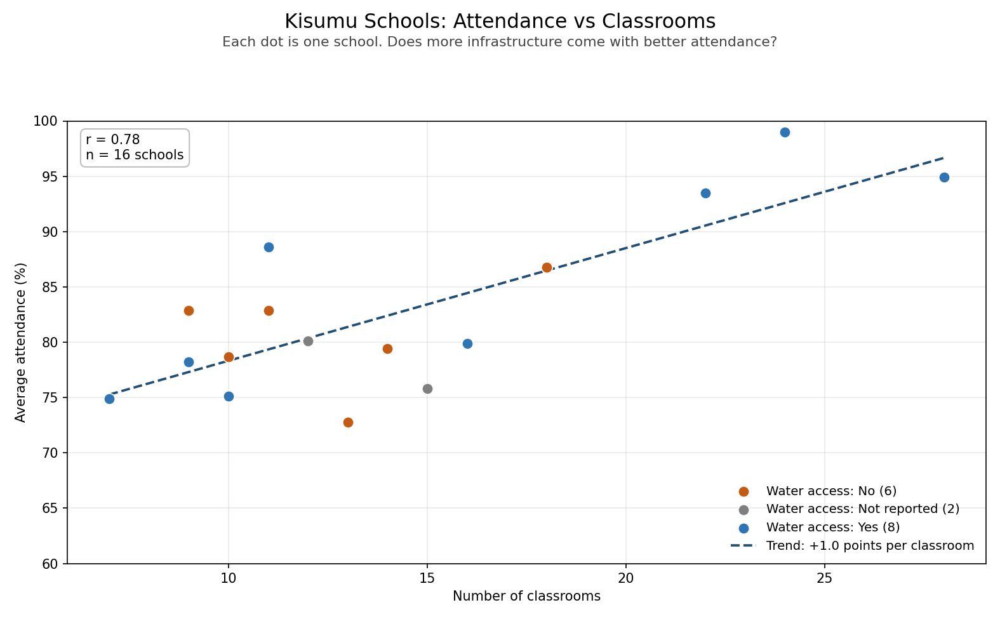

# Day 14: Multi-Dataset Analysis: Kisumu School Attendance

*Week 3 · Advanced Data Analysis · Two messy files, one clean merge, and a question neither file could answer alone.*

A Kisumu County education officer has attendance records in one file and school infrastructure in another. The two files disagree on column names and school-name formats, contain missing values, and one has a duplicate row. This project cleans both, merges them on the school name, and answers the officer's question: **do schools with more classrooms have better attendance?**



## The brief

> A county government in Kisumu has student attendance records in one file and school infrastructure data in another. The education officer wants to know: do schools with more classrooms have better attendance rates? The files use slightly different school name formats, have some missing values, and one has duplicate rows.

## The finding for the officer's report

> **Schools with more classrooms tend to have better attendance (r = 0.78, n = 16): each extra classroom is associated with about 1.0 percentage points more attendance, though this is an association and not proof that classrooms cause it.**

That sentence is printed by `school_analysis.py`, so it stays in step with the data. The rest of this README explains where it comes from and what it does not say.

## The two files

| File | Rows as received | Columns | Problems built in |
|---|---:|---|---|
| `data/attendance.csv` | 20 | `school`, `average_attendance_pct`, `county` | 2 missing attendance values; one name with a trailing space |
| `data/infrastructure.csv` | 21 | `school_name`, `num_classrooms`, `water_access` | 1 missing classroom count, 2 missing water records, 1 duplicate row, 7 messy name variants, 1 school absent (Dunga), 1 school extra (Rusinga) |

Both are written as CSV by `generate_sample_data.py` and loaded into DataFrames, which is what the exercise asks for with "create two sample DataFrames". Keeping the messy data in files makes the cleaning work visible and repeatable.

## What was wrong, and what the cleaning does

| Problem | Example | Handling |
|---|---|---|
| Different column names | `school` vs `school_name` | Load each with its own schema, then use one key |
| Capitals | `KISUMU BOYS HIGH SCHOOL` | Lowercase everything before comparing |
| Abbreviations | `Maseno Sch`, `Manyatta Pri Sch`, `Ahero Pry Sch` | Expand `pri`/`pry`/`prim` → `primary`, `sch` → `school` |
| Missing word | `Obunga Primary` vs `Obunga Primary School` | Drop a trailing `school`, which is the word most often left off |
| Punctuation | `St Marys School` vs `St. Mary's School` | Remove full stops and apostrophes |
| Extra spaces | `"  Nyalenda  Primary School "` | Strip the ends and collapse repeated spaces |
| Duplicate row | Kondele entered twice in the infrastructure file | `drop_duplicates()`, then check no duplicate school keys remain |
| Missing values | 2 attendance, 1 classroom count, 2 water records | Keep the rows, exclude those pairs from the correlation, label missing water as "Not reported" |
| Unmatched schools | Dunga only in attendance; Rusinga only in infrastructure | Inner merge, but print both names so the officer can chase the missing forms |

The name cleaner is deliberately conservative. It only collapses spellings that clearly refer to the same school. It does not try to guess that "Kisumu Boys" and "Kisumu Boys High" are the same if the rest of the name differs, because a wrong merge is worse than an unmatched row.

## The merge

```
Matched: 19 schools
In attendance only (no infrastructure row): Dunga Primary School
In infrastructure only (no attendance row): Rusinga Primary School
```

Nineteen schools appear in both files. Dunga's infrastructure form never arrived; Rusinga's attendance was not in the term file. Neither is silently dropped: they are named in the output so the officer can follow up. After removing the three matched schools with a missing value in one of the two measures (two missing attendance, one missing classroom count), **16 schools** have complete pairs.

## The result

| Measure | Value |
|---|---|
| Schools used | 16 |
| Attendance range | 72.8% to 99.0% (mean 82.7%) |
| Classrooms range | 7 to 28 (mean 14.3) |
| Pearson correlation | **r = 0.780** (strong positive) |
| p-value | **0.0004** |
| r-squared | **0.609** — classrooms explain about 61% of the variation |
| Slope | **+1.02 percentage points** of attendance per extra classroom |

Reading it plainly:

- The relationship is strong and statistically significant. More classrooms go with better attendance in this sample.
- Classrooms explain 61% of the differences in attendance. The other 39% sits in factors neither file records: class size, teacher numbers, distance from home, household income, health, and how attendance is counted.
- The slope is a useful planning number: across these 16 schools, one more classroom is associated with about **one more percentage point** of average attendance.

**Water access adds a second signal.** Schools with water access average **85.5%** attendance (8 schools) against **80.6%** for schools without (6 schools). The two schools with no water record average 77.9%. This does not separate the effect of water from the effect of being a larger, better-resourced school; both tend to arrive together. It does suggest that "more classrooms" is shorthand for "more resources", not a magic number.

**What the finding does not say.** It is an association, not a cause. Building classrooms would not by itself raise attendance by one point each. A school with 24 classrooms may simply be a bigger, better-funded school with more teachers, a library and water. With 16 schools, one unusual school can also move the correlation noticeably. The honest next step is to collect teacher numbers and class sizes, then compare schools with similar resources.

## Reading the chart

- Each dot is one school; the x-axis is the number of classrooms, the y-axis average attendance.
- Blue dots have water access, orange do not, grey did not report it. The blue points cluster higher, which is the water signal above.
- The dashed line is the trend from the 16 complete schools: about **+1 point per classroom**.
- The box in the corner gives **r = 0.78** and **n = 16**, so a reader can see how much data the line is based on.
- The y-axis starts at 60%, not zero, so the differences are readable. That is fine for showing a relationship, but the axis note matters: the same 20-point band would look flatter from zero.

## How to run it

```bash
cd Week3_AdvancedDataAnalysis/Day14
pip install pandas numpy matplotlib scipy

python generate_sample_data.py   # writes the two messy CSVs
python school_analysis.py        # cleans, merges, correlates, saves the chart
```

Or point it at other files:

```bash
python school_analysis.py path/to/attendance.csv path/to/infrastructure.csv
```

The attendance file needs `school`, `average_attendance_pct`, `county`; the infrastructure file needs `school_name`, `num_classrooms`, `water_access`.

## What the script does, step by step

| Step | pandas / scipy used | Why |
|---|---|---|
| 1. Load both files with their own column names | `read_csv` | The schemas genuinely differ; forcing one shape too early hides the problem |
| 2. Clean the school name into a key | `str` methods, `re.sub`, a word map | One reliable join key beats six ad-hoc fixes |
| 3. Remove exact duplicate rows | `duplicated`, `drop_duplicates` | The duplicate entry would otherwise double-count Kondele |
| 4. Check for duplicate keys after cleaning | `duplicated("school_key")` | Catches the dangerous case: two spellings of one school with different numbers |
| 5. Convert numbers and count missing values | `to_numeric`, `isna` | A missing classroom count is not zero classrooms |
| 6. Merge on the key | `merge(..., how="inner")` | Inner join keeps only schools with both records |
| 7. Report both kinds of unmatched school | set difference on the key | A school lost in a merge is a finding, not housekeeping |
| 8. Correlate classrooms and attendance | `scipy.stats.pearsonr`, `np.polyfit` | r, p, r² and the slope in one pass |
| 9. Compare water-access groups | `groupby(...).agg()` | Adds a second resource signal |
| 10. Draw the scatter | `scatter`, trend line, `n`/`r` box | Shows the shape, not just a coefficient |
| 11. Write the officer's sentence | f-string driven by r, p and slope | The finding stays consistent with the numbers |

## The sample data

`generate_sample_data.py` makes 20 fictional Kisumu schools with a fixed seed (14), so every run produces the same files:

- 4 secondary schools and 16 primary schools, with 6 to 28 classrooms.
- Attendance built from a base, a classroom effect, a water-access bonus and random variation, then clipped to 55–99%.
- Two schools with no attendance reported, one with no classroom count, two with no water record.
- One school missing from infrastructure (Dunga) and one extra school in it (Rusinga).
- Seven different name formats across the two files, plus a trailing space and duplicate row.

It is deliberately messy in the ways real county files are messy, not randomly corrupted.

## Files

| File | What it is |
|---|---|
| `generate_sample_data.py` | Makes both sample CSVs (fixed seed) |
| `data/attendance.csv` | Attendance: 20 schools |
| `data/infrastructure.csv` | Infrastructure: 21 rows as received |
| `school_analysis.py` | Clean, merge, correlate, chart, report |
| `attendance_vs_classrooms.png` | The scatter plot for the officer |
| `README.md` | This guide and the report sentence |

## What I practised

- Reading two files with different schemas instead of forcing them to match by hand
- Building one robust join key: case, punctuation, spacing, abbreviations, and the missing word "school"
- Removing duplicate rows and then checking for duplicate keys, which is the subtler failure
- Handling missing values by exclusion and disclosure, not by filling them with zero
- Inner-merging and reporting **both** sides of what did not match
- `scipy.stats.pearsonr` together with `r²` and a regression slope, so the finding has a size as well as a direction
- Adding a second variable (water access) to test whether "classrooms" is standing in for something broader
- Writing one sentence an education officer can put in a report without a statistics footnote
