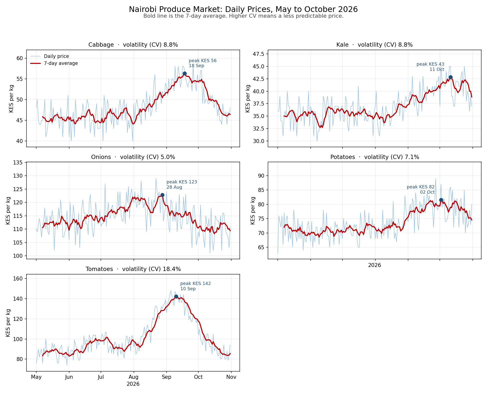

# Day 15 Exercise, Option 1: Nairobi Produce Market Volatility

*Week 3 · Advanced Data Analysis · Five vegetables, six months, one volatility question.*

A market analyst tracks daily prices for five vegetables at a Nairobi market over six months. The question for the report is simple to ask and easy to answer badly: **which vegetable is the most volatile, and when does its price peak?**



## The brief (Option 1)

> A market analyst is tracking vegetable prices in Nairobi. Using a dataset of daily prices for five common vegetables (tomatoes, kale, onions, cabbage, potatoes) over six months, identify which vegetable has the most volatile price, when prices peak, and create one time series chart per vegetable. Write a short finding explaining the pattern.

## The finding

> **Tomatoes were the most volatile vegetable, with a coefficient of variation of 18.4% and a 7-day average peaking at KES 142/kg on 10 September 2026; onions were the steadiest at 5.0%.**

Printed by `analysis.py` from the computed table, not typed by hand.

## Why volatility is measured with the coefficient of variation

Onions average KES 114.6/kg and kale averages KES 37.1/kg. Kale swings about KES 3.30 around its mean; onions swing about KES 5.80. Comparing standard deviations alone would call **onions** the more volatile vegetable — but that is just because onions cost three times as much.

The coefficient of variation (CV) divides the standard deviation by the mean, which removes the price level:

```
CV % = standard deviation ÷ mean × 100
```

On that scale onions are the calmest vegetable in the basket at **5.0%**, and tomatoes are the most erratic at **18.4%**. A trader can use CV directly: a vegetable with a CV of 18% is one where the price you see this week tells you very little about next week's price.

## The volatility ranking

| Rank | Vegetable | Mean (KES/kg) | Std dev | CV % | 6-month low | 6-month high | Peak of 7-day average |
|---:|---|---:|---:|---:|---:|---:|---|
| 1 | **Tomatoes** | 101.7 | 18.7 | **18.4%** | 74 | 148 | KES 142 on 10 Sep 2026 |
| 2 | Kale | 37.1 | 3.3 | 8.8% | 30 | 45 | KES 43 on 11 Oct 2026 |
| 3 | Cabbage | 48.3 | 4.2 | 8.8% | 40 | 58 | KES 56 on 18 Sep 2026 |
| 4 | Potatoes | 73.7 | 5.3 | 7.1% | 63 | 89 | KES 82 on 02 Oct 2026 |
| 5 | Onions | 114.6 | 5.8 | **5.0%** | 101 | 129 | KES 123 on 28 Aug 2026 |

Kale and cabbage are effectively tied at 8.8%. The ranking below tomatoes is a soft one; the gap between tomatoes (18.4%) and everything else (under 9%) is the finding.

The **peak** column uses a 7-day rolling average, not the single highest day. A single spike can be a bad delivery or a data entry error; a 7-day average peaking means the price genuinely stayed high for a week, which is what matters to a buyer negotiating a contract.

## Monthly average prices

| Month | Cabbage | Kale | Onions | Potatoes | Tomatoes |
|---|---:|---:|---:|---:|---:|
| May 2026 | 45.7 | 35.4 | 112.0 | 70.9 | 86.1 |
| Jun 2026 | 45.2 | 35.3 | 113.5 | 70.2 | 93.0 |
| Jul 2026 | 46.1 | 35.4 | 117.5 | 71.5 | 94.6 |
| Aug 2026 | 49.4 | 35.9 | 119.7 | 72.5 | 112.7 |
| Sep 2026 | 54.6 | 39.6 | 114.4 | 79.0 | **132.4** |
| Oct 2026 | 49.1 | 40.9 | 110.1 | 78.3 | 92.0 |

Tomatoes tell the clearest story: KES 86.1 in May, a slow climb to KES 132.4 in September, then a fall of 40 points in October. The other four vegetables drift within a narrow band all year. That is the same conclusion as the CV table, reached a second way — which is the point of checking.

**Seasonality.** The peak sits at the end of the long rains / start of the short-rains gap, the period when tomato supply in Nairobi is thinnest. Four of the five vegetables peak in September or October. Onions peak earliest, in August, and then fall — a different supply chain from the others.

## Reading the chart

`charts/vegetable_prices.png` has five panels, one per vegetable:

- The **pale line** is the daily price; the **bold red line** is the 7-day rolling average, which removes the day-to-day noise.
- The **blue dot and label** mark the peak of the 7-day average, so the annotation reports something robust rather than a one-day outlier.
- Every panel title carries that vegetable's **CV**, so the ranking is visible without reading the table.
- **Y-axis scales differ per panel** (tomatoes 74–148, kale 30–45). Each panel is meant to show the shape of its own series; the CV in the title is what makes the panels comparable. Reading the visual steepness across panels would be misleading, and the CV is there precisely so you do not have to.
- All panels share the same x-axis, May to October 2026, so the peaks can be compared in time at a glance.

## The data

`generate_sample_data.py` writes 920 rows — 184 days × 5 vegetables — with a fixed seed (15):

| Column | Type | Meaning |
|---|---|---|
| `date` | date | Daily, 2026-05-01 to 2026-10-31 |
| `vegetable` | text | Tomatoes, Kale, Onions, Cabbage, Potatoes |
| `price_kes_per_kg` | integer | Market price in Kenya shillings per kilogram |

Each series is built from a base price, a seasonal bump (a Gaussian curve), day-to-day noise, and a small weekend uplift — market prices run about 3% higher on Saturdays and Sundays. Tomatoes also get a second, smaller bump in June, so their year looks like a real tomato year instead of one smooth curve. The parameters are chosen so the volatility ranking is a property of the data rather than of any one lucky day.

**It is synthetic data.** The patterns are realistic, but this is a practice dataset, not a scrape of a real market.

## How to run it

```bash
cd Week3_AdvancedDataAnalysis/Day15/exercise
pip install pandas numpy matplotlib

python generate_sample_data.py      # writes data/vegetable_prices.csv
python analysis.py                  # prints the tables and saves the chart
```

Or point it at another file:

```bash
python analysis.py path/to/vegetable_prices.csv
```

The file needs `date`, `vegetable` and `price_kes_per_kg`.

The loader stops with a plain message, rather than a stack trace, if the file is missing, a column is absent, a date is not a real date, a price is missing, or a price is zero or less. Duplicate `(date, vegetable)` rows are kept once, last value wins.

## What the script does, step by step

| Step | pandas / numpy used | Why |
|---|---|---|
| 1. Read and validate | `read_csv`, `to_datetime`, `to_numeric` | Stop early on bad dates or prices |
| 2. De-duplicate and pivot | `drop_duplicates`, `pivot` | One column per vegetable, indexed by date |
| 3. Describe each series | `mean`, `std`, `min`, `max` | The ingredients of volatility |
| 4. Normalise for price level | `std / mean * 100` | CV, so a KES 37 vegetable can be compared with a KES 115 one |
| 5. Smooth each series | `rolling(7).mean()` | Finds a peak that lasted, not a one-day spike |
| 6. Rank | `sort_values("cv_pct", ascending=False)` | The answer to the question |
| 7. Plot five panels | `subplots(3, 2)`, `plot`, `annotate` | One time series per vegetable, peak marked |
| 8. Write the sentence | f-string from the top and bottom rows | The finding cannot drift from the table |

## Files

| File | What it is |
|---|---|
| `generate_sample_data.py` | Makes the daily price CSV (fixed seed 15) |
| `data/vegetable_prices.csv` | 920 rows: date, vegetable, price |
| `analysis.py` | Validate, pivot, measure volatility, chart, print the finding |
| `charts/vegetable_prices.png` | Five time series panels with 7-day averages |
| `README.md` | This write-up |

## What I practised

- Choosing the right measure: CV instead of a raw standard deviation when the series have different price levels
- Using a rolling average to find a peak that reflects a week of trading rather than one day
- Building one panel per series with a shared time axis and a per-panel y-axis, and saying so in the write-up
- Resampling to monthly averages to confirm the volatility ranking a second way
- Turning a table into one sentence a market analyst can put in a report
- Validating input before analysis, with messages a non-programmer can act on
