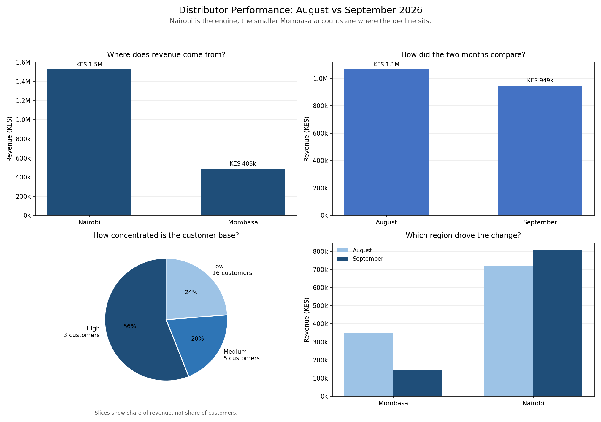

# Day 15 Project: Distributor Performance, August vs September 2026

*Week 3 · Advanced Data Analysis · Two monthly exports, one manager's question, four charts.*

A distributor sells fast-moving goods in Nairobi and Mombasa. Two monthly exports arrive with different column names and a few customers typed differently. The manager wants to know how the two months compare, which region carries the business, which customers matter, and what changed.



## The brief

> A distributor has two months of order data across two regions (Nairobi and Mombasa). It contains duplicated customers with slightly different names, missing values, and inconsistent formatting. Clean it, then build at least three charts, each answering a specific business question. Write a summary with at least four sentences of findings. Include a README and commit the chart images to GitHub.

## The findings

These four sentences are printed by `analysis.py`, so they stay in step with the data:

1. **Revenue fell 11.0% from August (KES 1,066,325) to September (KES 948,600), a drop of KES 117,725.**
2. **Nairobi contributed 76% of revenue from 51% of order lines, and its revenue rose 11.9% while Mombasa fell 58.9%.**
3. **The three biggest customers (Kamau Stores, Otieno Wholesale, Hassan Traders) now account for 68% of revenue and grew 35% in September, so the overall decline came from smaller accounts, which fell 48.6%.**
4. **6 customers who ordered in August placed no order in September, representing KES 85,770 of dormant revenue worth chasing before the end of the quarter.**

Put together: this is not a broad collapse. It is one region and one size of account. The top of the book got bigger while the long tail stopped ordering.

## The data

| File | Rows | Columns as received | Notes |
|---|---:|---|---|
| `data/sales_august.csv` | 112 | `date`, `client_name`, `county`, `product`, `qty`, `unit_price` | KES 1,066,325 revenue |
| `data/sales_september.csv` | 83 | `date`, `customer_name`, `region`, `product`, `quantity`, `price` | KES 948,600 revenue |

Both are written by `generate_sample_data.py` with a fixed seed (15). The two exports deliberately disagree in the ways real monthly exports disagree:

| Problem | August | September |
|---|---|---|
| Customer column | `client_name` | `customer_name` |
| Region column | `county` | `region` |
| Quantity column | `qty` | `quantity` |
| Price column | `unit_price` | `price` |
| Customer spellings | `"Kamau Stores "` (trailing space), `"Otieno  Wholesale"` (double space) | `"kamau stores"` (lowercase), `"LIKONI TRADERS"` (capitals) |

The duplicate customers are the reason the cleaning step matters. Without it, Kamau Stores would appear as three customers and the top-customer finding would be wrong.

## Cleaning

`load_month()` runs the same checks on each file before anything is combined:

| Check | What it catches | Action |
|---|---|---|
| Missing columns | An export that dropped a field | Stop with the column name and what was expected |
| Real dates | `2026-13-45` or an empty cell | Stop with the accepted format |
| Numeric quantity and price | Text in a numeric column | Stop, naming the file and count of bad rows |
| Missing or zero values | Quantity or price of 0 | Stop — a zero price is not a free order |
| Duplicate rows | The same order line exported twice | Remove, and say how many |
| Customer spelling | Case, extra spaces | `" ".join(str(name).split()).title()` |

The name cleaner is a single function: collapse whitespace, then title-case. So `"kamau stores"`, `"KAMAU STORES "` and `"Kamau  Stores"` all become `Kamau Stores`. It is deliberately blunt because customer names here are short and distinct; a fuzzy matcher would be needed if two real customers had near-identical names.

Both files are then stacked with `pd.concat`, labelled `August` / `September`, and revenue is calculated as `quantity × price`.

## The four charts, and the question each answers

| Chart | Question | What it shows |
|---|---|---|
| Bar: revenue by region | **Where does revenue come from?** | Nairobi KES 1.53M (75.8%), Mombasa KES 0.49M (24.2%) |
| Bar: revenue by month | **How did the two months compare?** | August KES 1.07M → September KES 0.95M, down 11.0% |
| Pie: revenue by customer tier | **How concentrated is the customer base?** | 3 High accounts hold 56% of revenue; the 16 Low accounts hold 24% |
| Grouped bars: region by month | **Which region drove the change?** | Nairobi up, Mombasa collapsed |

The fourth chart is the one that actually explains the first three. Nairobi grew from KES 720,305 to KES 806,320 (+11.9%) while Mombasa fell from KES 346,020 to KES 142,280 (−58.9%). A single total-revenue line would have hidden that completely.

## The numbers behind the findings

### Region

| Region | August | September | Change | Share of two-month revenue |
|---|---:|---:|---:|---:|
| Nairobi | 720,305 | 806,320 | **+11.9%** | 75.8% |
| Mombasa | 346,020 | 142,280 | **−58.9%** | 24.2% |

Nairobi also supplies only 99 of the 195 order lines (50.8%). It earns three-quarters of the money on half the paperwork because its order lines are much larger: about KES 15,400 of revenue per line against KES 5,100 in Mombasa. **Line count and revenue are not the same thing**, and this dataset is built so that a reader who counts orders alone gets the story backwards.

### Customer tiers

Tiers are set for this distributor's size, not copied from the lesson: two-month revenue of **KES 250,000+** is High, **KES 60,000+** is Medium, anything below is Low.

| Tier | Customers | Two-month revenue | Share |
|---|---:|---:|---:|
| High | 3 | 1,128,335 | 56.0% |
| Medium | 5 | 408,205 | 20.3% |
| Low | 16 | 478,385 | 23.7% |

### The top three

| Customer | Two-month revenue | August | September | Change | Tier |
|---|---:|---:|---:|---:|---|
| Kamau Stores | 469,645 | 200,120 | 269,525 | +34.7% | High |
| Otieno Wholesale | 376,175 | 160,040 | 216,135 | +35.1% | High |
| Hassan Traders | 282,515 | 120,505 | 162,010 | +34.4% | High |

Together they moved from KES 480,665 to KES 647,670 and now represent **68% of September revenue**. Every other account combined fell **48.6%**.

### Dormant accounts

Six Mombasa customers ordered in August and nothing in September:

| Customer | August revenue |
|---|---:|
| Tudor Traders | 22,545 |
| Mtwapa Mart | 18,100 |
| Shanzu Shop | 15,080 |
| Kongowea Traders | 11,995 |
| Voi Road Supplies | 10,075 |
| Ukunda Mart | 7,975 |
| **Total** | **85,770** |

Of the KES 203,740 Mombasa lost, **42% is these six accounts going quiet** — a recoverable list, not a market that disappeared.

### Products

For completeness, since the brief asks for a full picture: Unga 2kg (KES 606,535) and Rice 5kg (KES 558,015) lead, followed by Sugar 1kg, Soap 800g and Cooking Oil 1L. Product mix does not explain the month-on-month drop; the regional and customer split does.

## Reading the chart

- **Top left** sets the scale: Nairobi is three times Mombasa.
- **Top right** is the headline: the total is down, but only by 11%.
- **Bottom left** shows why the total is fragile — 3 of 24 customers produce 56% of the money, and the slices are revenue share, not headcount. A count-based pie would show 12% for those same three accounts and make the concentration look mild when it is not.
- **Bottom right** is the explanation: Nairobi's bar grows, Mombasa's bar more than halves.
- Y-axes start at zero on the bar charts on purpose: these are money totals shown to a manager, and a truncated axis would exaggerate the change.

## What the findings do not say

- **Nairobi growing does not mean Nairobi is healthy.** It means the three largest accounts bought more. Three customers is a thin base to depend on.
- **Mombasa's drop is concentrated, not broad.** Six quiet accounts explain 42% of it; the remaining loss is spread thinly across the other eight.
- **One month is not a trend.** September could be the start of a real decline or a single soft month. A third month would settle it.
- **Dormant is not lost.** Those customers may have switched supplier, cut back for the season, or simply not been called. The data cannot tell which; a phone call can.
- **The data is synthetic.** This is a realistic sample built for practice, not a real distributor's book.

## How to run it

```bash
cd Week3_AdvancedDataAnalysis/Day15/project
pip install pandas numpy matplotlib

python generate_sample_data.py   # writes the two monthly CSVs
python analysis.py               # cleans, combines, charts, prints findings
```

Output is deterministic: the same seed produces the same 195 order lines and the same KES 2,014,925 total on every run.

## What the script does, step by step

| Step | pandas / numpy used | Why |
|---|---|---|
| 1. Read each export with its own column map | `read_csv`, `rename` | The schemas genuinely differ; forcing one shape too early hides the mess |
| 2. Validate dates, numbers, signs | `to_datetime(errors="coerce")`, `to_numeric`, comparisons | A bad row should stop the report, not quietly become zero |
| 3. Clean customer names | `str.split`, `join`, `title` | One key per customer, or the top-customer finding is wrong |
| 4. Drop duplicate rows | `duplicated`, `drop_duplicates` | The same order line twice would inflate revenue |
| 5. Stack the months | `concat`, a `month` column | One tidy frame, long format |
| 6. Calculate revenue | `quantity * price` | The measure every chart uses |
| 7. Aggregate three ways | `groupby`, `pivot_table`, `size` | Region, month, and region × month answer different questions |
| 8. Build tiers | `np.where` on two thresholds | Turns 24 customers into a base a manager can reason about |
| 9. Compare months per customer | `pivot_table`, `fillna(0)`, `%` change | Finds growth, decline and dormancy in one table |
| 10. Draw the four panels | `bar`, `bar_label`, `pie`, grouped bars | Each panel answers exactly one question |
| 11. Write the four sentences | f-strings driven by the computed values | The narrative cannot drift from the numbers |

## Files

| File | What it is |
|---|---|
| `generate_sample_data.py` | Makes both monthly CSVs (fixed seed 15) |
| `data/sales_august.csv` | August: 112 order lines, 6 columns |
| `data/sales_september.csv` | September: 83 order lines, different column names |
| `analysis.py` | Clean, combine, analyse, chart, print findings |
| `charts/project_analysis.png` | The four-panel dashboard |
| `README.md` | This report |

## What I practised

- Reconciling two exports whose columns and customer spellings disagree
- Validating before aggregating: stopping on bad dates, non-numeric prices and zero quantities instead of silently dropping them
- Building a single customer key with a one-line normaliser
- Stacking long-format months and calculating a derived measure (`revenue`) once
- Answering a business question with a specific chart instead of a generic one
- Aggregating the same data three ways (`groupby`, `pivot_table`, `size`) and knowing which answers which question
- Reading order count against revenue and catching that they tell different stories
- Choosing tier thresholds for the actual business rather than copying the lesson's numbers
- Writing findings that are checkable against the tables, including what the data cannot tell us
