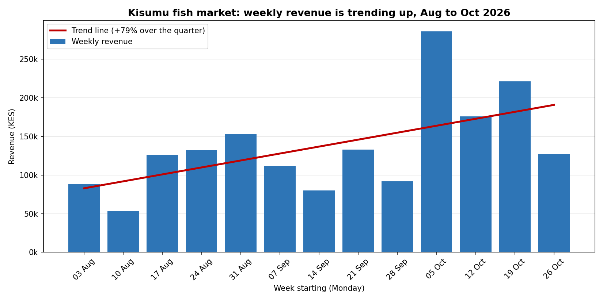

# Day 20 Exercise: Kisumu Fish Market Sponsor Report

*Week 4 · SQL for Data · Three months of digital sales, three questions, one printable report.*

A Kisumu fish market association moved its vendors from paper books to digital sales records in August 2026. Their county government sponsor wants to know what the first three months show. The report has to answer three questions with data and be clean enough to print and hand over.

**The report itself is [`report.md`](report.md).**



## The brief

> Create a SQLite database with at least 50 rows of fish market transactions (vendor name, fish type, kg sold, price per kg, date, buyer type: retail or wholesale). Answer: (1) Which three vendors generated the most revenue? (2) Is wholesale or retail more profitable per kg on average? (3) Is total revenue trending up, flat, or down? Write SQL, pull into pandas, create one chart, and write a 200-word report with your three findings and one recommendation. Save the report as a markdown file.

## The three answers

| Question | Answer |
|---|---|
| 1. Top three vendors by revenue | **Otieno & Sons** (KES 447,068), **Akinyi Fish Stall** (KES 349,032), **Awino Fresh Fish** (KES 230,094). Together **58%** of the market's KES 1,777,476. |
| 2. Wholesale or retail per kg? | **Retail**: KES 324/kg against KES 254/kg wholesale, a 28% premium. Within each fish type the premium is 11% to 22%. Wholesale still earns **60%** of revenue, because a wholesale sale averages 77 kg against 18 kg. |
| 3. Revenue trend | **Up.** The weekly trend line rises 79% over the quarter. Average revenue per selling day went from KES 17,758 in August to KES 20,713 in September and KES 33,170 in October. |

**Recommendation:** connect the five smaller vendors to wholesale buyers (schools, hotels). The top three earn about 70% of their revenue from wholesale; the other five earn 29% to 55% and together hold 42% of the market.

## How to run it

```bash
cd Week4_SQLBasics/Day20/exercise
pip install pandas numpy matplotlib

python generate_fish_market_data.py   # builds data/fish_market.db
python analysis.py                    # prints the answers, saves the chart and report.md
```

`analysis.py` opens the database read-only. It stops with one plain sentence, not a traceback, if the database is missing, if a column is missing, if a date is not a real date, or if the table is empty.

## The data

`generate_fish_market_data.py` writes **180 sales** with a fixed seed (20), one table:

| Column | Type | Meaning |
|---|---|---|
| `sale_id` | integer | Row key |
| `sale_date` | text, `YYYY-MM-DD` | Trading days, Monday to Saturday, 3 Aug to 31 Oct 2026 |
| `vendor` | text | One of eight stalls |
| `fish_type` | text | Tilapia, Nile Perch, Omena, Catfish |
| `kg_sold` | real | Kilograms in the sale |
| `price_per_kg` | integer | KES per kg, quoted in multiples of 5 |
| `buyer_type` | text | `retail` or `wholesale`, enforced by a `CHECK` |

Wholesale buyers get roughly 18% off and buy about four times the volume. The number of sales logged per day rises through the quarter as more vendors use the digital book. An index on `sale_date` supports the trend queries. **The data is synthetic**; the database is generated output and is not committed.

## From question to SQL

| Question | SQL | pandas on top |
|---|---|---|
| Top three vendors | `GROUP BY vendor`, `SUM(kg_sold * price_per_kg)`, `ORDER BY revenue DESC` | Revenue share per vendor |
| Wholesale vs retail per kg | `SUM(revenue) / SUM(kg)` per `buyer_type`, plus a per-fish-type check with `CASE WHEN` | Retail premium % per fish type |
| Trend | Weekly totals with `date(sale_date, 'weekday 0', '-6 days')`; monthly totals with `LAG` | Straight-line fit (`numpy.polyfit`) and an up/flat/down verdict |

Three choices make the answers honest:

- **Revenue per kg is weighted.** `SUM(kg × price) / SUM(kg)` counts every kilogram once. A plain `AVG(price_per_kg)` would let a 3 kg sale count as much as a 90 kg one. Both are printed; the weighted figure is the one in the report.
- **The retail premium is checked inside each fish type.** The headline premium (28%) is partly a mix effect, because wholesale buyers take more omena, the cheapest fish. Comparing like with like (11% to 22%) shows the premium is real, and the report quotes both figures.
- **"Profitable" means revenue per kg.** The records hold selling prices, not what the vendor paid for the fish, so true profit can't be calculated. The report says so in a footnote rather than hiding it.

### The trend verdict

Weekly revenue is noisy: one big hotel order can double a week. So the verdict comes from a straight line fitted through the 13 weekly totals, not from comparing two weeks. A line that moves less than 10% of an average week across the quarter counts as **flat**, above +10% is **up**, below −10% is **down**. This quarter the line moves **+79%**, far outside the flat band.

The monthly check uses **revenue per day with sales**, because October had 27 selling days and September 22. October's raw total is 96.5% above September's; per day it is 60% higher. The per-day figure is the fair one, and it still points up.

## The chart

One chart, as the brief asks: weekly revenue bars with the fitted trend line in red. The title states the verdict, so a reader gets the answer before looking at the bars. The chart also shows the week-to-week swings, which keeps anyone from reading a single strong week as the trend.

## Files

| File | What it is |
|---|---|
| [`generate_fish_market_data.py`](generate_fish_market_data.py) | Builds `data/fish_market.db`: 180 sales, fixed seed 20, `CHECK` constraints, date index |
| [`analysis.py`](analysis.py) | Five SQL queries through `pandas.read_sql_query`, the trend fit, the chart and the report |
| [`report.md`](report.md) | The sponsor report: three findings and one recommendation, about 200 words |
| [`charts/weekly_revenue.png`](charts/weekly_revenue.png) | Weekly revenue with trend line |
| `data/fish_market.db` | Generated database. Not committed; rebuild with the generator |

The report is written by `analysis.py` from the query results, so every number in it matches the tables printed on screen.

## Pricing note

**What a consulting firm would charge.** A Nairobi research or consulting firm would treat this as a small market study. That means a day to design and load the database, a day of analysis, and a day to write and format a sponsor-ready report, with a manager reviewing it. At typical firm day rates of KES 35,000 to 50,000, that comes to about **KES 100,000 to 150,000**.

**What I am charging: KES 18,000.**

| Work | Hours |
|---|---:|
| Agree the three questions and the data fields with the association | 1.5 |
| Build the database and load three months of records | 3 |
| Write and check the SQL and the trend method | 3 |
| Chart, 200-word report and one round of edits | 2.5 |
| **Total** | **10** |

10 hours at **KES 1,800/hour**. The rate sits a little above my Week 4 rate of KES 1,500 to 1,750 because the output is a finished document for a government sponsor, not an internal report. The association keeps the database and the script, so next quarter's report is a re-run: **KES 6,000** for refreshing the data and updating the wording.

## What was practised

- Designing a single-table schema with `CHECK` constraints and an index matched to the main query
- `GROUP BY` with calculated revenue, `ORDER BY` to rank
- A weighted average in SQL (`SUM(a × b) / SUM(b)`) instead of `AVG`
- Conditional aggregation (`CASE WHEN` inside `SUM`) to compare retail and wholesale side by side per fish type
- SQLite date functions to bucket sales into Monday-start weeks
- `LAG` for month-on-month change, and normalising by days with sales
- Pulling SQL results into pandas and adding a trend fit with `numpy.polyfit`
- Writing a 200-word report generated from the data, with the limits of the data stated

## Requirements

```
pip install pandas numpy matplotlib
```

Python 3.10 or later. SQLite ships with Python. Charts use the `Agg` backend, so no display is needed.
