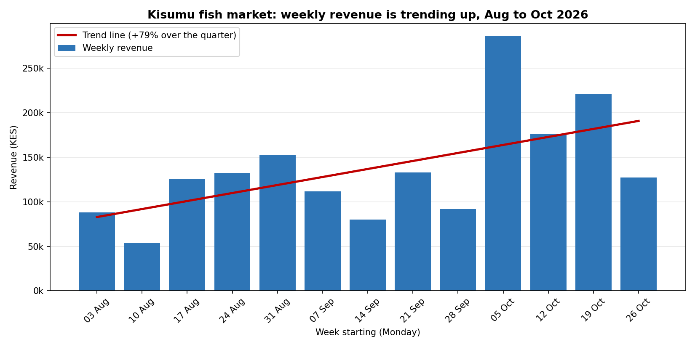

# Kisumu Fish Market: First Quarter of Digital Sales

**Prepared for:** County Government sponsor, Kisumu Fish Market Association
**Period:** 3 August to 31 October 2026 · 8 vendors · 180 recorded sales · KES 1,777,476 total revenue

## Findings

**1. Three vendors earn 58% of the market's revenue.** Otieno & Sons (KES 447,068), Akinyi Fish Stall (KES 349,032), Awino Fresh Fish (KES 230,094).

**2. Retail earns more per kg; wholesale earns more in total.** Retail buyers paid KES 324/kg against KES 254/kg for wholesale, a 28% premium; within each fish type the premium is 11% to 22%. Wholesale still brought in 60% of revenue, because the average wholesale sale was 77 kg against 18 kg.

**3. Revenue is trending up.** Average revenue per selling day went from KES 17,758 in August to KES 33,170 in October. The weekly trend line moves +79% across the quarter, though single weeks swing widely; the best week began 5 October.

## Recommendation

Connect the five smaller vendors to wholesale buyers such as schools and hotels. The top three earn 70% of their revenue from wholesale; the other five earn 29% to 55% and together hold only 42% of the market. Bulk contracts would spread the growth beyond three stalls, while retail sales keep the higher price per kg.

*Note: the records show selling prices, not what vendors paid for fish, so "profitable per kg" here means revenue earned per kg.*
