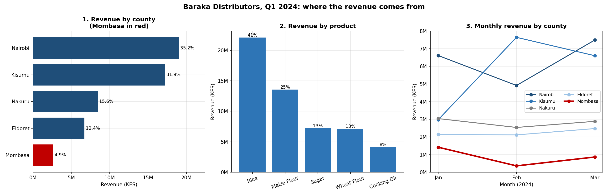

# Day 20 Project: Baraka Distributors Q1 2024 Database Analysis

*Week 4 · SQL for Data · One database, three business questions, SQL for the data and pandas for the insight.*

Baraka Distributors sells five dry-goods lines (rice, maize flour, wheat flour, cooking oil, sugar) to shops in five counties. The owner wants a first-quarter review drawn from the sales database rather than from the order book. This project follows the lesson's five steps: build the database, query it, add a pandas layer, chart it, and write the findings for the client.

**The client report is [`findings_report.md`](findings_report.md).**



## The three business questions

| # | Question | Answer |
|---|---|---|
| 1 | Which products drive revenue? | **Rice** (KES 22.1M, 41%) and **Maize Flour** (KES 13.6M, 25%) together bring in **66%** of revenue. Cooking Oil is the smallest line at 8%. |
| 2 | Where is revenue concentrated, and which county is underpenetrated? | **Nairobi** (35.2%) and **Kisumu** (31.9%) carry **67%** of sales. **Mombasa** has **4.9%**: 9 orders against Nairobi's 69. Its average order (KES 293,278) is in line with the network (KES 278,812), so the gap is in how often shops order, not how much. |
| 3 | Is the business growing month to month, and is every county keeping up? | Revenue rose **26%**, from KES 16.2M in January to KES 20.3M in March (+8.6% in February, +15.6% in March). **Mombasa fell 39%** over the same months, and Nakuru slipped 5%. |

**Recommendation:** increase Mombasa stock allocation and assign a dedicated sales contact. Matching Eldoret, the smallest established county, would add about **KES 4.1M per quarter**, roughly 14 more orders at Mombasa's current order size.

## How to run it

```bash
cd Week4_SQLBasics/Day20/project
pip install pandas numpy matplotlib

python generate_baraka_data.py   # builds data/baraka_distributors.db
python analysis.py               # prints the tables, saves the chart and findings_report.md
```

`analysis.py` opens the database read-only. It stops with one plain sentence if the database is missing, if a column is missing, if a date is not a real date, or if the table is empty.

## The data

The table is the lesson's `sales` table, unchanged in shape, with `CHECK` constraints added so a zero quantity or a zero price is refused when it is inserted:

| Column | Type | Meaning |
|---|---|---|
| `id` | integer | Row key |
| `date` | text, `YYYY-MM-DD` | Working days, Monday to Saturday, 2 Jan to 30 Mar 2024 |
| `product` | text | Rice, Maize Flour, Wheat Flour, Cooking Oil, Sugar |
| `county` | text | Nairobi, Kisumu, Nakuru, Eldoret, Mombasa |
| `quantity` | integer | Bales or cartons |
| `unit_price` | integer | KES per bale or carton (the lesson's prices, plus sugar at 3,600) |

`generate_baraka_data.py` writes **194 orders** worth **KES 54,089,500** with a fixed seed (2024), plus indexes on `county` and `date`, the two columns every query groups by. The lesson's six sample rows show the idea; a full quarter gives the questions enough data to answer them properly. Each county gets orders at its own rate, and Mombasa, opened late in 2023, gets the fewest. **The data is synthetic.** The database is generated output and is not committed.

## SQL gets the data, pandas shapes the insight

| Step | SQL | pandas |
|---|---|---|
| Products | `GROUP BY product`: revenue, units, order count | Revenue share and cumulative share |
| Counties | `GROUP BY county`: revenue, units, orders, average order value | Revenue share; Mombasa's gap to the smallest established county |
| Months | Monthly totals in a CTE, then `LAG` for the month-on-month change | — |
| County by month | `GROUP BY county, month` | `pivot` to a county × month table, `fillna(0)` for a month with no orders |

Two decisions are worth explaining:

- **Average order value next to the order count.** The lesson's report says Mombasa is underpenetrated. That is true, but on its own it doesn't tell the owner what to fix. Putting `COUNT(*)` beside `SUM / COUNT` shows that Mombasa's orders are normal-sized and simply rare. That points the recommendation at winning more shops, not at discounts.
- **A reachable benchmark.** The gap is measured against Eldoret, the smallest established county, not Nairobi. "Match Nairobi" would be KES 16M and nobody would believe it. "Match Eldoret" is KES 4.1M, about 14 more orders in a quarter, a target one sales contact can be held to.

## The chart

`charts/baraka_analysis.png` has three panels, one per question. Mombasa is red in every panel where it appears, so the eye finds it immediately:

1. **Revenue by county**: horizontal bars, labelled with each county's share.
2. **Revenue by product**: bars labelled with share, largest first.
3. **Monthly revenue by county**: one line per county. Mombasa is the thick red line, falling while the others hold or grow.

## Files

| File | What it is |
|---|---|
| [`generate_baraka_data.py`](generate_baraka_data.py) | Builds `data/baraka_distributors.db`: the lesson's `sales` table, 194 orders, fixed seed 2024, two indexes |
| [`analysis.py`](analysis.py) | Four SQL queries via `pandas.read_sql_query`, the pandas layer, the chart and the report |
| [`findings_report.md`](findings_report.md) | The client report: three findings and a recommendation, every number from the queries |
| [`charts/baraka_analysis.png`](charts/baraka_analysis.png) | Three-panel chart |
| `data/baraka_distributors.db` | Generated database. Not committed; rebuild with the generator |

## Pricing note

**KES 20,000** for the quarterly review: 11 hours at KES 1,800/hour, covering setting up the database from the order book (4), queries and checks (3), and the chart and written findings (4). A consulting firm would quote this as a two-to-three-day engagement, about **KES 80,000 to 120,000**. Each later quarter is a re-run plus new wording, at **KES 7,000**. The Mombasa recommendation alone is worth about KES 4.1M a quarter if it lands, so the review pays for itself many times over.

## What was practised

- Building a SQLite database from Python with constraints and indexes
- Analytical SQL: `GROUP BY` with calculated revenue, `COUNT`, average order value
- A CTE plus `LAG` for month-on-month change
- Loading query results with `pd.read_sql_query` and adding shares, cumulative shares and a pivot in pandas
- One chart panel per business question, with the problem county highlighted throughout
- Turning the numbers into a written findings report with a measurable recommendation

## Requirements

```
pip install pandas numpy matplotlib
```

Python 3.10 or later. SQLite ships with Python.
