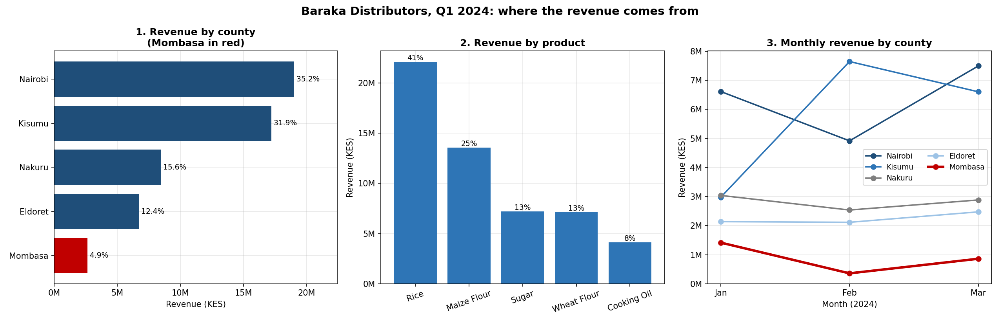

# Project Findings Report: Baraka Distributors Q1 2024

**Period:** 2 January to 30 March 2024 · 194 orders · 5 counties · 5 products
**Total revenue:** KES 54,089,500

## 1. Top revenue driver

**Rice** earned KES 22,072,500, 41% of total revenue. Second is **Maize Flour** at KES 13,566,000. Together these two products generate **66%** of all revenue. Cooking Oil is the smallest line at 8%.

## 2. Geographic concentration

**Nairobi** (35.2%) and **Kisumu** (31.9%) account for **67%** of sales. **Mombasa** is significantly underpenetrated at **4.9%**.

The problem in Mombasa is how often shops order, not how much they order. Mombasa placed **9 orders** in the quarter, against 69 in Nairobi, yet its average order was KES 293,278, close to the network average of KES 278,812. The shops that buy are buying properly; there are too few of them.

## 3. Month-to-month trend

Revenue grew from KES 16.2M in January to KES 20.3M in March, up **26%** across the quarter. February changed by +8.6% and March by +15.6%.

Not every county kept up: Mombasa (-39%) and Nakuru (-5%) ended March below their January level. Mombasa took KES 1,417,500 in January, KES 360,000 in February and KES 862,000 in March. While the network grew, Mombasa shrank, so the gap is widening rather than closing on its own.

## Recommendation

**Increase Mombasa stock allocation and assign a dedicated sales contact for that county.** The target is realistic: if Mombasa matched Eldoret, the smallest established county (KES 6,729,500 this quarter), it would add about **KES 4,090,000 per quarter**, roughly 14 more orders at Mombasa's current order size. The contact's job is to win more shops, not bigger orders, since order size is already in line with the network.

*Data: Baraka Distributors sales database, `sales` table. Figures produced by `analysis.py`; synthetic practice data.*
