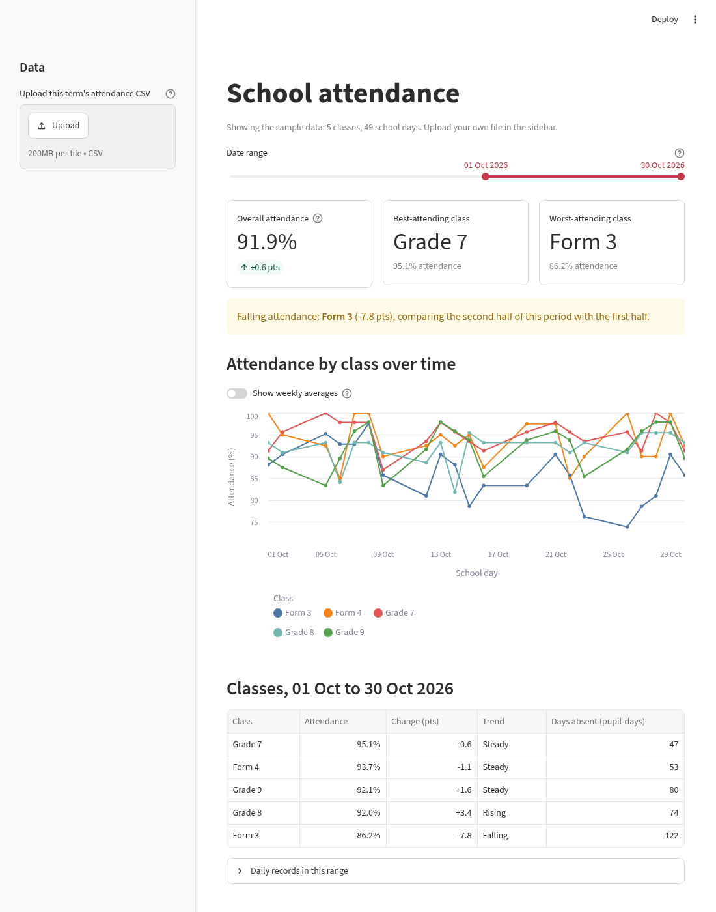
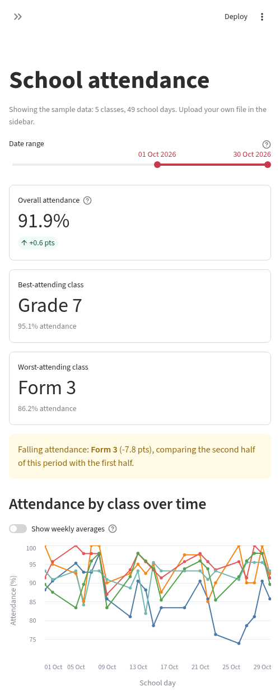

# Day 21: Nakuru School Attendance Dashboard

*Week 5 · Dashboards and Reporting · A Streamlit page the principal opens every morning instead of Excel.*

A school principal in Nakuru wants to check attendance without opening a spreadsheet every morning. She needs one page on her phone or laptop with the overall attendance rate, attendance by class, and a chart of the last 30 days, so she can see early if a class is starting to slip.



## The brief

> Build a Streamlit app that loads a CSV of daily attendance records (date, class_name, students_present, students_total). Show three metrics at the top: overall rate, best-attending class, worst-attending class. Add a slider to filter the date range. Show a line chart of attendance rate over the selected range, one line per class. Use a realistic sample CSV with at least 8 weeks of data across 5 classes.
>
> Push to GitHub including your sample CSV. README explains how to run it and what CSV format it expects.

## How to run it

```bash
cd Week5_DashboardsandReporting/Day21
pip install streamlit pandas numpy

python generate_attendance_data.py      # optional: rebuilds data/attendance.csv
streamlit run attendance_dashboard.py
```

A browser tab opens at `http://localhost:8501`. The sample CSV is committed, so the generator step is only needed to rebuild it. To use the school's own register, click **Upload** in the sidebar (on a phone, tap `>>` at the top left to open it) and choose the CSV.

## What the page shows

| Part | What it tells the principal |
|---|---|
| **Date range slider** | Opens on the last 30 days of the file. Drag either end to look at any part of the term. |
| **Overall attendance** | Pupils present ÷ pupils on the register across every class in the range. The green or red arrow shows the change in percentage points against the same number of days just before the range. |
| **Best- and worst-attending class** | The highest and lowest class for the range, with the rate under the name. |
| **Falling attendance warning** | Appears only when a class's rate in the second half of the range is 2 points or more below the first half. |
| **Line chart** | One line per class, one point per school day. Hover or tap a point to see the class, rate, and the number present out of the number on the register. The **Show weekly averages** switch smooths out single bad days. |
| **Class table** | Rate, change, trend (Falling, Steady, Rising) and pupil-days absent for each class. |
| **Daily records** | The rows behind the chart, folded away under an expander. |



On a phone, the three metrics stack and the chart shrinks to fit the screen.

## What the sample data shows

With the default view (1 to 30 October 2026):

- Overall attendance is **91.9%**, up 0.6 points on September.
- **Grade 7** is the best-attending class at **95.1%**. **Form 3** is the worst at **86.2%**.
- **Form 3 is falling.** Its rate is 7.8 points lower in the second half of October than the first. Weekly, it went from 92.9% in the week of 5 October to 81.9% in the week of 26 October. Every other class held steady or rose.
- The week of 21 September is low for every class. That is the whole school, not one class, so it does not trigger a warning.

This is the situation the brief describes: one class slipping while the school's overall number still looks healthy. Overall attendance alone would not have shown it.

## The CSV format

One row per class per school day. Column names must match exactly; any extra columns are ignored.

| Column | Type | Example | Meaning |
|---|---|---|---|
| `date` | date | `2026-10-30` | The school day. `YYYY-MM-DD` is best; `30/10/2026` (day first, as Excel writes it in Kenya) also works. |
| `class_name` | text | `Form 3` | The class or stream, written the same way every day |
| `students_present` | whole number | `33` | Pupils marked present |
| `students_total` | whole number | `42` | Pupils on the class register that day |

```csv
date,class_name,students_present,students_total
2026-10-30,Grade 7,44,46
2026-10-30,Form 3,33,42
```

Weekends and holidays simply have no rows. If a class appears twice on the same day, the two rows are added together.

If the file has a problem, the page shows one plain sentence instead of an error screen, for example:

- *The file is missing the column(s): students_total. It needs these four columns: …*
- *1 row(s) have a date that could not be read. Please write dates as YYYY-MM-DD, for example 2026-10-30.*
- *1 row(s) have more students present than on the register, for example Form 3 on 01 Oct 2026.*
- *That file could not be read as a CSV. In Excel, use File > Save As > CSV (Comma delimited) and upload it again.*

## The sample data

`generate_attendance_data.py` writes `data/attendance.csv` with a fixed seed (21): **245 rows**, 5 classes over **49 school days**, Monday 24 August to Friday 30 October 2026 (ten weeks of Term 3).

| Class | On register | Usual rate |
|---|---:|---:|
| Grade 7 | 46 | 95% |
| Grade 8 | 44 | 93% |
| Grade 9 | 48 | 92% |
| Form 3 | 42 | 91% |
| Form 4 | 40 | 94% |

Each day's attendance is drawn pupil by pupil around the class's usual rate, with the patterns a real register has:

- Mondays and Fridays run 2 to 2.5 points lower than midweek.
- A wet week (21 to 25 September) takes about 5 points off every class.
- No school on Mashujaa Day, Tuesday 20 October.
- From 5 October, Form 3 drops about 1.5 points a week. This is the decline the dashboard has to catch.

**The data is synthetic.** The CSV is committed because the brief asks for it and the app loads it by default.

## Choices that keep the numbers honest

- **Rates are pooled, not averaged.** The overall rate is total present ÷ total on the register. Averaging each class's percentage would let a class of 40 count as much as a class of 48.
- **"Falling" compares halves of the range, with a 2-point threshold.** In a class of about 45 pupils, one or two absences move the daily rate by 2 to 4 points. A single-day dip is noise; a half-period gap of 2 points or more is a pattern worth a conversation.
- **The chart's y-axis does not start at zero.** Attendance lives between about 75% and 100%. Starting at zero would flatten a 10-point drop into a barely visible wiggle. The axis label shows the scale.
- **The slider opens on the last 30 days,** because that is what the principal asked to see each morning. The full term is one drag away.

## Files

| File | What it is |
|---|---|
| [`attendance_dashboard.py`](attendance_dashboard.py) | The Streamlit app: load and check the CSV, slider, metrics, warning, chart, table |
| [`generate_attendance_data.py`](generate_attendance_data.py) | Writes the sample CSV, fixed seed 21 |
| [`data/attendance.csv`](data/attendance.csv) | Sample data: 5 classes, 49 school days |
| [`screenshots/dashboard.png`](screenshots/dashboard.png) | The page on a laptop |
| [`screenshots/dashboard_phone.png`](screenshots/dashboard_phone.png) | The page on a phone |

`app.py` in this folder is my practice app from the lesson steps (the Kamau Stores sales demo). It is in `.gitignore` and is not part of the submission.

## Pricing note

**KES 15,000 to build, KES 1,500 a month to run.** That covers 8 hours (agreeing the CSV layout with the school office, building and testing the app, deploying it to Streamlit Cloud, and a 30-minute walk-through with the principal) at about KES 1,800/hour, plus the monthly fee for help when the register changes. Today, checking attendance by class means 15 to 20 minutes in Excel each morning, about 60 hours a term. The dashboard gives the answer in under a minute, and the falling-attendance warning catches a slipping class weeks before the end-of-term totals would.

## What I practised

- Running a Python script as a web app with `streamlit run`
- Page setup with `st.set_page_config`, `st.title`, `st.caption` and `st.subheader`
- KPI cards with `st.metric` and `st.columns`, including a delta and a help tooltip
- A date-range `st.slider` that returns two dates and filters a DataFrame
- `st.file_uploader` in the sidebar, with the sample file as the fallback
- `st.cache_data` so the sample CSV is read once, not on every interaction
- `st.error` plus `st.stop` to replace tracebacks with one clear sentence
- `st.warning` to flag a falling class only when there is one
- An Altair line chart in `st.altair_chart`: one line per class, tooltips, a legend that wraps on a phone, and a y-axis set to the range that matters
- `st.toggle` to switch the chart between daily and weekly views
- `st.dataframe` with `column_config` for percentage and signed-change formats, and `st.expander` for the raw rows
- Pooled rates with `groupby` and sums, and a first-half versus second-half comparison to detect a decline
- Reading both ISO and day-first dates safely with `pd.to_datetime`
- Testing the app headlessly with `streamlit.testing.v1.AppTest`, and checking the layout at phone width

## Requirements

```
pip install streamlit pandas numpy
```

Python 3.10 or later. Streamlit installs Altair, which draws the chart. Built and tested with Streamlit 1.67.
