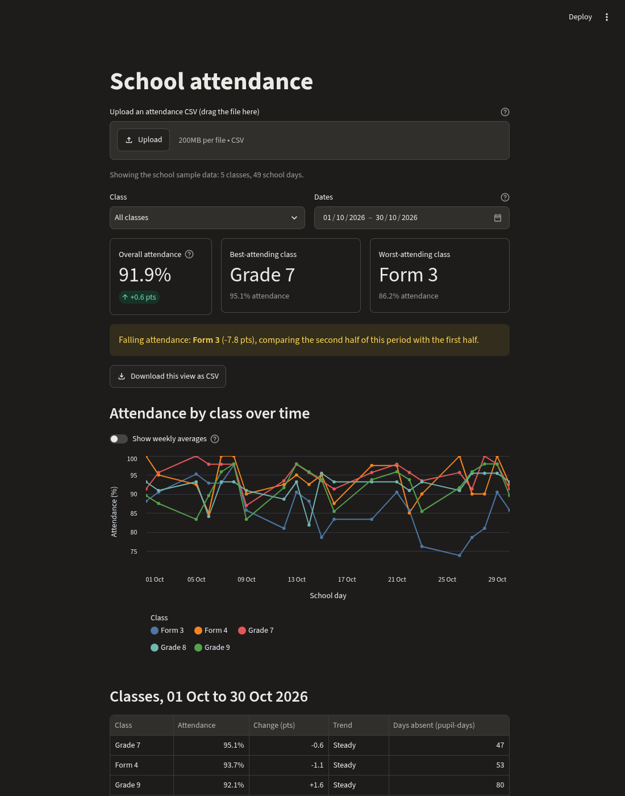
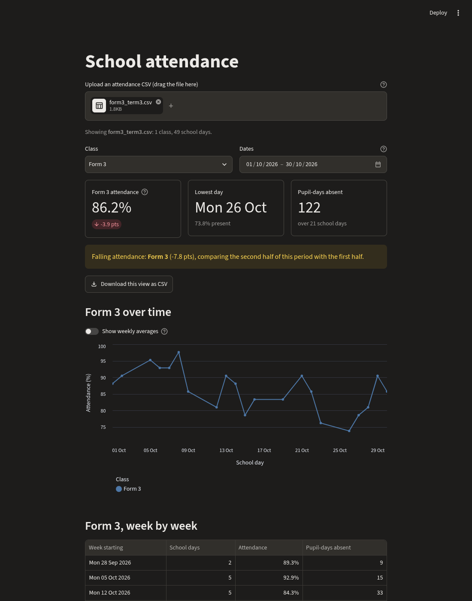
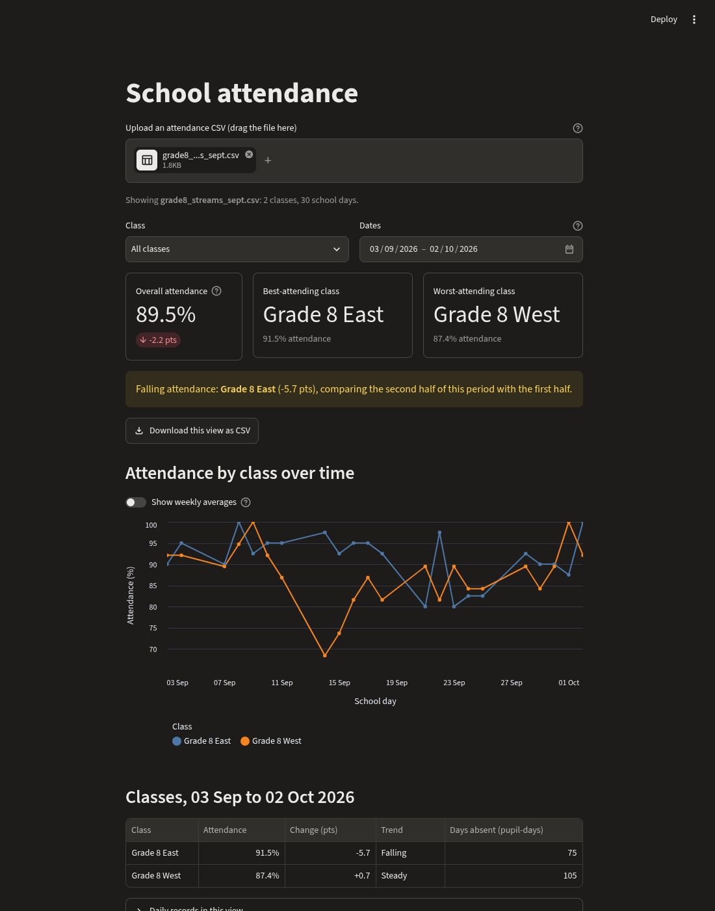

# Day 22: Attendance Dashboard for Class Teachers

*Week 5 · Dashboards and Reporting · The Day 21 dashboard, extended so each class teacher can drag in their own sheet and filter, check and download their class.*

The Nakuru principal now wants to share the dashboard with her class teachers. Each teacher should be able to upload their own attendance sheet and see their own class, without anyone touching the code.



## The brief

> Extend your attendance dashboard with: a dropdown to filter by class name, a date range picker, and a file uploader so a teacher can drag in a new CSV and the dashboard updates immediately without touching code. Add a download button for the filtered view. Test with at least two different uploaded files to confirm filters and upload work together.
>
> Push to GitHub. Add to your README: what you would charge to build and deploy this for a school, and whether you would price per school or per teacher.

## How to run it

```bash
cd Week5_DashboardsandReporting/Day22
pip install streamlit pandas numpy

python generate_attendance_data.py      # optional: rebuilds the sample files
streamlit run attendance_dashboard.py
```

The page opens on the school's sample file. To try it as a teacher, drag `data/teacher_uploads/form3_term3.csv` or `data/teacher_uploads/grade8_streams_sept.csv` onto the upload box at the top of the page.

## What changed from Day 21

Day 21's version is still in [`../Day21`](../Day21). This folder started as a copy of it.

| Day 21 | Day 22 |
|---|---|
| Uploader hidden in the sidebar | Uploader at the top of the page, so a teacher sees it first, including on a phone |
| Every class always shown | **Class dropdown**: "All classes" or one class |
| Date slider | **Date range picker** with a calendar, dates shown day first (`01/10/2026`) |
| The upload was re-read on every click | The upload is cached on the file's contents, so filters are instant and a new file is read fresh |
| No way to take the numbers away | **Download this view as CSV**: the class and dates chosen, in the same layout as the upload |
| One layout | One class gets its own view: its rate, its lowest day, pupil-days absent, and a week-by-week table |

## How the filters and the upload work together

- **A new file resets the filters.** The dropdown and the date picker are tied to the uploaded file. Dragging in a different sheet gives a fresh class list and a fresh date range, so the page never keeps a class or dates that the new file doesn't have.
- **The dropdown lists only the classes in the file.** A Form 3 teacher's sheet has one class, so the dropdown shows just "Form 3" and the page opens on that class. A sheet with two streams shows "All classes" plus each stream.
- **The date picker is limited to the file's dates** and opens on the last 30 days of the file. While a teacher has picked only the start date, the page says "Now pick the end date." instead of drawing a half-filtered view.
- **The download is exactly what is on screen**: the chosen class and dates, with an `attendance_pct` column added. The file is named after the view, for example `attendance_grade_8_west_2026-09-07_to_2026-09-25.csv`, and can be uploaded again as it is.
- **A bad file** gets one sentence naming the file and the problem, never a traceback.

## Testing with two uploaded files

`generate_attendance_data.py` now writes two teacher sheets next to the school file. Each one is shaped differently, so the upload has to cope with more than the format I designed:

| File | What makes it different |
|---|---|
| [`form3_term3.csv`](data/teacher_uploads/form3_term3.csv) | One class, 49 days. Dates written the Excel way (`24/08/2026`), the columns in a different order, and an extra `class_teacher` column |
| [`grade8_streams_sept.csv`](data/teacher_uploads/grade8_streams_sept.csv) | Two streams, Grade 8 East and Grade 8 West, which are not in the school file. Only six weeks (24 Aug to 2 Oct), with a flu week in Grade 8 West |

I ran the app with Streamlit's `AppTest`, which clicks through the page without a browser. Then I repeated the uploads by hand in Chrome against the running server.

| Step | Result |
|---|---|
| School file, all classes | 91.9% overall, Grade 7 best, Form 3 worst and flagged as falling (−7.8 pts) |
| School file, choose Form 4 | Switches to the one-class view: 93.7%, lowest day Tue 06 Oct, 53 pupil-days absent |
| **Upload 1:** `form3_term3.csv` | Excel dates read correctly. Dropdown shows only Form 3. Same Form 3 numbers as the school file (86.2%, falling), which confirms the two files agree |
| Upload 1, widen to the full term | 88.5% for the term. Week-by-week table shows the slide: 92.9% → 84.3% → 83.9% → 81.9% over October |
| **Upload 2:** `grade8_streams_sept.csv` | Dropdown resets to All classes / Grade 8 East / Grade 8 West. Dates reset to 3 Sep to 2 Oct |
| Upload 2, Grade 8 West, 7 to 25 Sep | Lowest day Mon 14 Sep. The week of 14 Sep drops to 78.4% (the flu week), then recovers to 85.8% |
| Pick only a start date | "Now pick the end date." |
| Upload a file with the wrong columns | *bad.csv: The file is missing the column(s): class_name, students_present, students_total. …* |
| Remove the upload | Back to the school file and its filters |
| Download, Grade 8 West, 7 to 25 Sep | 15 rows, only Grade 8 West, only those dates. Uploading the downloaded file works |





One result worth explaining. In the Grade 8 file's default view (3 Sep to 2 Oct), **Grade 8 East** is flagged as falling, not West. The wet week (21 to 25 Sep) lands in the second half of that window, while West's flu week lands in the first half. The warning is right about the numbers in the window. It is a prompt to look at the chart, not a verdict, and the chart shows the real story straight away.

## The CSV format

Unchanged from Day 21. One row per class per school day; the column order doesn't matter and extra columns are ignored.

| Column | Type | Example | Meaning |
|---|---|---|---|
| `date` | date | `2026-10-30` or `30/10/2026` | The school day. ISO dates first; anything else is read day first, as Excel writes it in Kenya |
| `class_name` | text | `Grade 8 West` | The class or stream, written the same way every day |
| `students_present` | whole number | `33` | Pupils marked present |
| `students_total` | whole number | `38` | Pupils on the class register that day |

## A note on privacy

The dropdown is a **filter, not a lock**. If the school file is loaded, any teacher with the link can choose any class. The brief's goal of teachers seeing only their own class is met here by what each teacher uploads: a Form 3 teacher who uploads the Form 3 sheet only ever has Form 3 on screen.

For a real deployment I would:

- start the page empty, with no school file preloaded, so the link shows nothing until a sheet is uploaded
- put the app behind a sign-in, so only the school's staff can open it
- if the principal wants teachers to see the school file, give each teacher an account tied to their class

Uploaded files are held in the server's memory for the session; nothing is written to disk. The sheets hold class counts, not pupil names, which keeps the data low-risk under Kenya's Data Protection Act. It would be different if a school wanted pupil-level registers, and I would raise that before building it.

## Files

| File | What it is |
|---|---|
| [`attendance_dashboard.py`](attendance_dashboard.py) | The Streamlit app: upload, class dropdown, date picker, metrics, chart, tables, download |
| [`generate_attendance_data.py`](generate_attendance_data.py) | Writes the school file and the two teacher sheets, fixed seed 21. The school file is identical to Day 21's |
| [`data/attendance.csv`](data/attendance.csv) | School sample: 5 classes, 49 school days |
| [`data/teacher_uploads/`](data/teacher_uploads) | The two teacher sheets used for testing |
| [`screenshots/`](screenshots) | The page with the school file and after each teacher upload |

All data is synthetic.

## Pricing: what I would charge a school

**KES 35,000 to build and deploy, then KES 2,500 a month. Priced per school, not per teacher.**

| Work | Hours |
|---|---:|
| Agree the sheet layout with the school office; check it against their real Excel register | 2 |
| Build and test the dashboard (Days 21 and 22) | 10 |
| Deploy behind a sign-in, with staff accounts | 3 |
| One hour of training for the class teachers, plus a one-page "how to upload" guide | 2 |
| Fixes in the first two weeks of use | 2 |
| **Total** | **19** |

19 hours at about KES 1,800/hour comes to roughly KES 34,000, rounded to **KES 35,000**. The **KES 2,500 a month** covers hosting (about KES 1,000 for a small server) and up to an hour of support: a new stream, a changed Excel layout, a teacher who can't upload. A second school costs much less to set up, about **KES 15,000**, because the app already exists; most of that is the sheet check, accounts and training.

**Why per school:**

- **My costs don't grow with teachers.** It is one app on one server. The 20th teacher costs me almost nothing more than the 5th.
- **Per-teacher pricing works against the goal.** The principal wants every class teacher using it. Charging per head makes her choose who gets access, and the class that most needs watching might be the one left out.
- **Schools buy per school.** The board approves a line item for the school, not a headcount licence that changes each term as staff move.
- **It is simpler for everyone.** One invoice, one price, nothing to recount when a teacher joins or leaves.

To stay fair across schools of different sizes, I would use bands rather than a per-teacher rate: **KES 2,500 a month up to 20 classes, KES 4,000 for 21 to 50**, because support grows with the number of classes. Per-teacher pricing would only make sense if I sold directly to individual teachers with no school involved. Then something like KES 300 per teacher per month would fit a teacher's own budget.

**Value to the school:** a class teacher spends 10 to 15 minutes a week working out attendance in Excel. Across 15 teachers over a 13-week term, that is 30 to 50 hours a term. The dashboard gives each of them the answer in a minute, and the falling-attendance warning catches a slipping class weeks earlier.

## What I practised

- `st.selectbox` for the class dropdown, with "All classes" only when the file has more than one class
- `st.date_input` with a `(start, end)` value for a date range, limited to the file's dates, and handling the half-picked state
- Widget `key`s tied to the uploaded file's `file_id`, so a new upload resets the filters instead of keeping stale choices
- `st.file_uploader` on the main page, with each problem reported in a sentence that names the file
- `st.cache_data` on the uploaded file's bytes, so filtering does not re-read the file
- `st.download_button` with `on_click="ignore"`, serving the filtered rows as a CSV named after the view
- A different layout for one class: the lowest day with `idxmin`, and a week-by-week table built with `to_period("W-SUN")`
- `st.columns` with uneven widths, so long stream names fit in the metric cards
- Generating test files shaped differently from my own format (Excel dates, reordered and extra columns, new class names, a shorter range) to check the upload
- Testing uploads with `AppTest.file_uploader().set_value()`, then repeating them in a real browser
- Thinking through pricing (per school vs per teacher) and what the dropdown does and doesn't protect

## Requirements

```
pip install streamlit pandas numpy
```

Python 3.10 or later. Streamlit installs Altair, which draws the chart. Built and tested with Streamlit 1.67.
