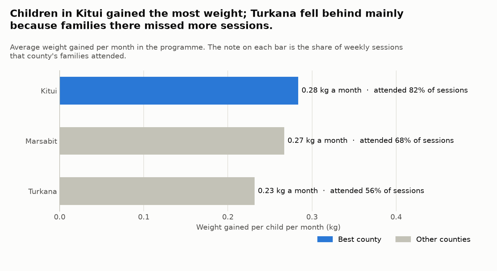
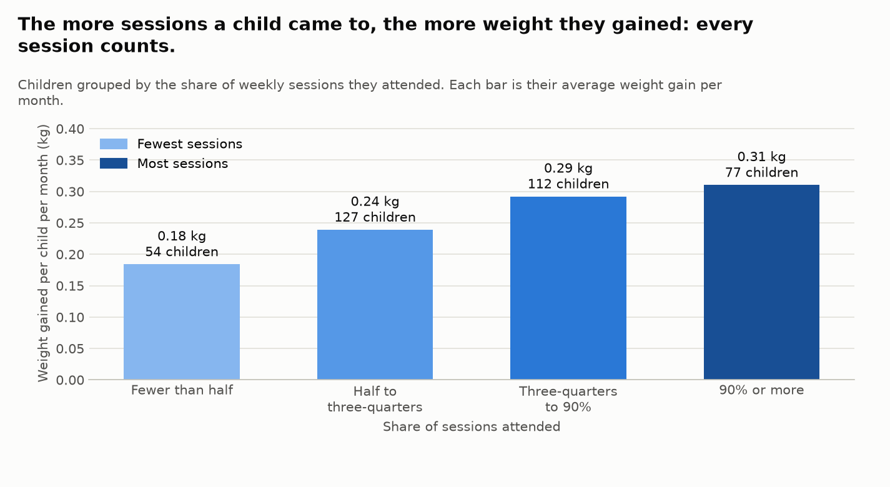
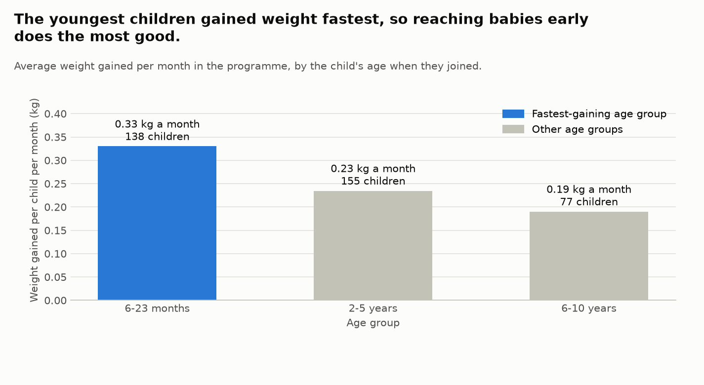

# Day 23: Six-Month Nutrition Programme Story for a Donor

*Week 5 · Dashboards and Reporting · Three findings, three headlines, three charts, and a talk that fits in five minutes.*

A Nairobi NGO runs a child nutrition programme in Kitui, Marsabit and Turkana. It has a 10-minute meeting to show a donor six months of outcomes. The donor is not a data person, so the job is to turn the records into a story they can follow and act on.

## The three headlines

1. **Children in Kitui gained the most weight; Turkana fell behind mainly because families there missed more sessions.**
2. **The more sessions a child came to, the more weight they gained: every session counts.**
3. **The youngest children gained weight fastest, so reaching babies early does the most good.**

Each headline says what the finding **means**, in plain words, with no statistics. The numbers live in the charts and in [`findings.md`](findings.md), the donor brief.

## The brief

> Create a dataset of nutrition program outcomes (county, participant age group, weight gain kg, sessions attended, months in program). Find three findings: one about which county performed best, one about whether attendance correlates with outcomes, one about age group differences. Write a headline for each finding in plain language with no jargon and no statistics in the headline. Choose the right chart type for each. Present all three findings aloud to yourself or a friend in under five minutes. Write down any question they ask that you cannot immediately answer from your data.
>
> Push the charts and three headlines to GitHub. Add a pricing note: what would you charge an NGO for a six-month program analysis?

## How to run it

```bash
cd Week5_DashboardsandReporting/Day23
pip install pandas numpy matplotlib

python generate_nutrition_data.py   # writes data/nutrition_outcomes.csv
python story_analysis.py            # prints the tables, saves the charts and findings.md
```

`story_analysis.py` stops with one plain sentence if the data file is missing, a column is missing, a number is blank, or a child attended more sessions than were held.

## The findings and their charts

### 1. Which county did best



**Chart choice:** horizontal bars, sorted, with Kitui in blue and the others in grey. The question is "which county", so one bar per county with the winner highlighted answers it at a glance. Each bar carries its attendance rate, because that is the explanation.

| County | Children | Kg gained a month | Sessions attended |
|---|---:|---:|---:|
| Kitui | 130 | 0.28 | 82% |
| Marsabit | 115 | 0.27 | 68% |
| Turkana | 125 | 0.23 | 56% |

The headline's "mainly because" is checked, not assumed. Among children who came to at least three sessions in four, Kitui's lead over Turkana shrinks from 0.05 to 0.02 kg a month, so most of the county gap is an attendance gap. The script only writes that headline when the data supports it.

### 2. Does attendance make a difference



**Chart choice:** four bars for four attendance bands, in steps of blue from light to dark. I chose bars over a scatter plot of 370 dots: a donor reads "each step up is taller" instantly, while a scatter needs explaining. The correlation is r = 0.46 (a clear, moderate link), which is in this README but not in front of the donor.

| Share of sessions attended | Children | Kg gained a month |
|---|---:|---:|
| Fewer than half | 54 | 0.18 |
| Half to three-quarters | 127 | 0.24 |
| Three-quarters to 90% | 112 | 0.29 |
| 90% or more | 77 | 0.31 |

Regular attenders gained 69% more a month than children who came to fewer than half the sessions.

### 3. Age group differences



**Chart choice:** bars in age order (youngest first, so the axis reads like growing up), with the fastest group in blue. Age order matters more than sorting by value here, because the story is "younger is faster".

| Age group | Children | Kg gained a month | Sessions attended |
|---|---:|---:|---:|
| 6-23 months | 138 | 0.33 | 67% |
| 2-5 years | 155 | 0.23 | 69% |
| 6-10 years | 77 | 0.19 | 73% |

The youngest children attended slightly *less* than the others and still gained the most, so the difference comes from age, not effort.

### How each finding is framed for the donor

[`findings.md`](findings.md) gives every finding three lines: **what we expected**, **what happened**, **why it matters**. It ends with three requests the donor can say yes to:
- transport for Turkana families
- a follow-up call after two missed sessions
- enrolling children under two first

The brief is written by `story_analysis.py` from the data, so every number in it matches the tables.

## One choice that keeps the comparison fair

Children joined in waves, so some have been in the programme six months and some only one. Comparing **total** weight gain would make the counties with more long-stayers look best. Every figure here is **kg gained per month in the programme**, pooled: total kg ÷ total child-months. A child with six months counts six times as much as a child with one. That is fair, because a one-month figure is mostly day-to-day noise on the scale, while six months shows a real trend.

## Presenting it: the five-minute run-through

[`talk_track.md`](talk_track.md) is the script: an opening line, one short section per chart, and the ask. It is 375 spoken words, about 3 to 4 minutes with pauses. The rules I set myself, from the lesson:
- say what the chart means, never read it out
- show one chart at a time
- a number only when asked, then straight back to what it means

The test of a good run-through: the listener can repeat the main point in their own words. *"Kids who come more often gain more weight, so help Turkana families get there, and start with babies."*

### Questions the data cannot answer

While writing the talk I listed the questions a donor is likely to ask. These are the ones I **cannot** answer from this dataset, and what the NGO would need to collect:

| Likely question | Can the data answer it? | What would answer it |
|---|---|---|
| Why do Turkana families come less often? Is it distance? | **No.** There is no travel time or reason for absence | Record how far each family travels and why a session was missed |
| Did the children reach a healthy weight? | **No.** Only the gain is recorded, not starting weight, height or age in months | Record weight and height at enrolment and each month, and compare against WHO growth standards |
| Would they have gained this weight anyway? | **No.** There is no comparison group | Compare with children on the waiting list, or with county health records |
| What does it cost per child, or per kilo gained? | **No.** There is no cost data | The programme budget split by county |
| Are girls and boys doing equally well? | **No.** Sex is not recorded | Add it to the enrolment form |
| Does the weight stay on after a child leaves? | **No.** No follow-up after the programme | A three-month follow-up weigh-in |
| Did any child lose weight? | **Yes.** One child out of 370 | Already in the data |
| Which county has the most children enrolled? | **Yes.** Kitui (130), Turkana (125), Marsabit (115) | Already in the data |

The first three are the ones a donor is most likely to push on. Saying "we don't know yet, and here is how we will find out" is a stronger answer than guessing.

## Files

| File | What it is |
|---|---|
| [`generate_nutrition_data.py`](generate_nutrition_data.py) | Writes the sample data: 370 children, fixed seed 23 |
| [`story_analysis.py`](story_analysis.py) | Works out the three findings, checks each headline against the data, draws the charts, writes the brief |
| [`findings.md`](findings.md) | The donor brief: headlines, charts, expected / happened / why it matters, the three requests |
| [`talk_track.md`](talk_track.md) | What to say, chart by chart, in under five minutes |
| [`charts/`](charts) | The three charts, one per finding |
| `data/nutrition_outcomes.csv` | Generated by the first script. Not committed; rebuild it with the generator |

**The data is synthetic.** Columns: `participant_id`, `county`, `age_group`, `months_in_program` (1 to 6), `sessions_attended` (four sessions a month), `weight_gain_kg`.

## Pricing note: a six-month programme analysis for an NGO

**KES 38,000, or KES 32,000 at my rate for registered NGOs.**

| Work | Hours |
|---|---:|
| Collect and clean the programme records from three counties | 6 |
| Analysis: the three findings, and checking each one holds up | 5 |
| Charts, headlines and the written donor brief | 5 |
| Talk track, plus a rehearsal with the programme manager | 2 |
| One round of revisions after the NGO's review | 2 |
| Being on call for the donor meeting | 1 |
| **Total** | **21** |

21 hours at KES 1,800/hour is KES 37,800, rounded to **KES 38,000**. For a registered NGO I would drop to **KES 32,000**: the work is the same, but most programme budgets set aside only a small line for monitoring and evaluation, and a fair price wins the next round. Payment is half at the start and half on delivery of the brief.

The NGO keeps the scripts. The **12-month report** is a re-run with new data plus a refreshed story: **KES 15,000**. If they start recording the missing fields above (starting weight and height, travel time, sex), I would add the healthy-weight and distance analysis at that point for **KES 10,000** more.

Not included: collecting the data in the field, or a formal impact evaluation with a comparison group. That is a larger study, and I would say so up front rather than let the donor assume this analysis proves the programme caused the weight gain.

## What I practised

- Starting from the findings, then choosing the chart, instead of making charts and hoping for a story
- Writing headlines that say what a finding means, in plain language with no statistics
- Choosing a chart type per finding: sorted bars to pick a winner, ordered bars for a dose-response story, bars in natural order when the order is the point
- Emphasis colour: one blue for the point of the chart, grey for context, and a light-to-dark blue ramp for ordered groups
- Putting the headline in the chart title and the numbers in the subtitle and labels
- Checking a causal-sounding headline ("mainly because they missed sessions") against the data before using it, by comparing counties among regular attenders only
- A fair comparison when people join at different times: gain per child-month, pooled
- The expected / what happened / why it matters structure for each finding
- Writing a talk track to time, and listing the questions the data cannot answer and what to collect next
- Generating the brief from the data, so the numbers in the words always match the charts
- Pricing an analysis for an NGO, and stating plainly what it does not prove

## Requirements

```
pip install pandas numpy matplotlib
```

Python 3.10 or later. Charts use the `Agg` backend, so no display is needed.
