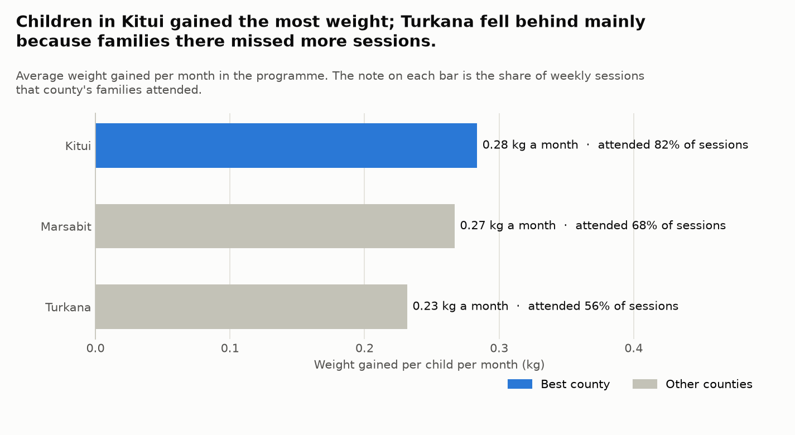
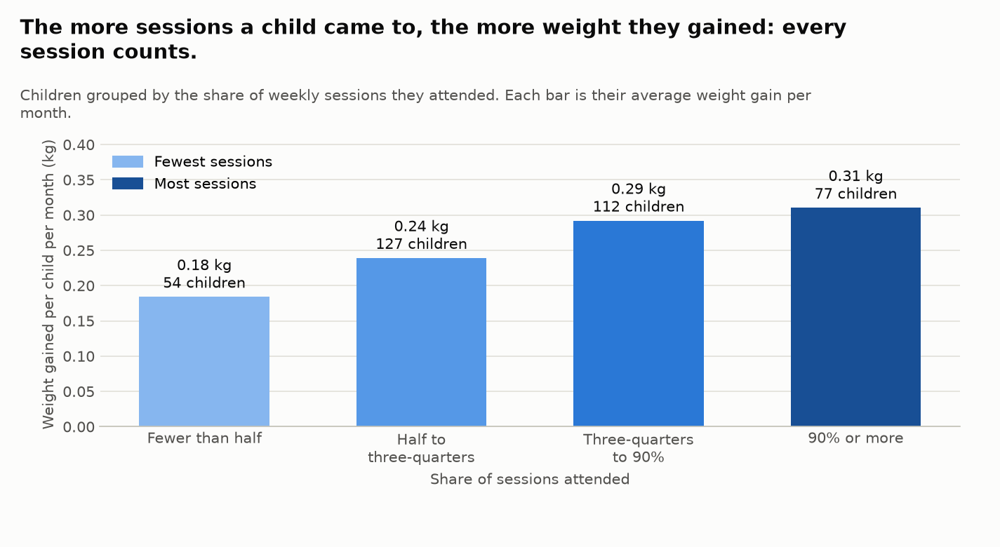
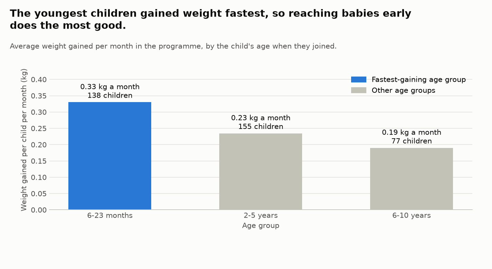

# Six months of the child nutrition programme: what the donor needs to know

*370 children in Kitui, Marsabit, Turkana, May to October 2026. Together they gained **397 kg**.*

All figures are weight gained **per month in the programme**, because children joined at different times.

## 1. Children in Kitui gained the most weight; Turkana fell behind mainly because families there missed more sessions.

- **What we expected:** similar results in all three counties. The programme, the food basket and the sessions are the same everywhere.
- **What happened:** children in Kitui gained 0.28 kg a month and children in Turkana 0.23 kg. Families in Kitui came to 82% of sessions; families in Turkana came to 56%.
- **Why it matters:** among children who came to at least three sessions in four, the gap between Kitui and Turkana shrinks by more than half (0.02 kg a month, against 0.05 kg overall). Turkana is not failing; its families are missing sessions. Helping them attend, for example with transport or sessions closer to home, is the fix.

## 2. The more sessions a child came to, the more weight they gained: every session counts.

- **What we expected:** children who attend more should gain more, because each session brings a supervised meal, a weight check and advice for the parent.
- **What happened:** children who came to 90% or more of sessions gained 0.31 kg a month. Children who came to fewer than half gained only 0.18 kg, so the regular attenders gained 69% more each month. Weight gain rises at every step of attendance.
- **Why it matters:** attendance is the lever the programme controls. Every extra session a family makes is more weight for the child. Following up with families who miss two sessions in a row is a simple, low-cost way to improve results.

## 3. The youngest children gained weight fastest, so reaching babies early does the most good.

- **What we expected:** the youngest children to respond fastest, because the first two years are when a child catches up most quickly.
- **What happened:** children aged 6-23 months gained 0.33 kg a month, against 0.19 kg for children aged 6-10 years. Their attendance was no better than the others' (67%), so the difference is the age, not the effort.
- **Why it matters:** the same sessions do more for a baby than for an older child. The next phase should find and enrol children under two first.

## What we ask the donor to support

1. Transport or outreach sessions for Turkana families, so attendance there reaches the Kitui level.
2. A follow-up call after any two missed sessions, in every county.
3. Enrolment that starts with children under two.

*Data: programme records, synthetic sample for this exercise.*
