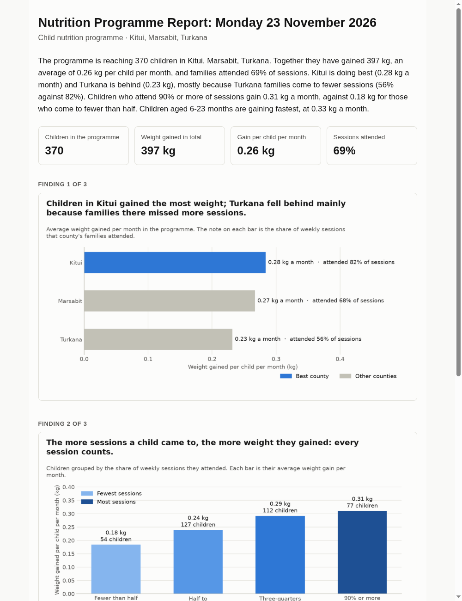

# Day 24: Monday Morning Nutrition Programme Report

*Week 5 · Dashboards and Reporting · The Day 23 findings, turned into a dated HTML report that builds itself every Monday at 07:00.*

The NGO's programme director wants a report every Monday morning without having to ask for it. She wants one HTML file she can open in a browser, print or forward, with the date on it so she knows it is current.



## The brief

> Build a Python script that reads your nutrition program CSV, generates three charts as PNG files, and produces a self-contained HTML report with the current date in the title, a one-paragraph summary, and all three charts embedded. Save it as report_YYYY-MM-DD.html. Schedule it to run every Monday at 7am. Test by running it twice and confirming you get two separate dated HTML files with charts that load in the browser without extra files.
>
> Push to GitHub. README explains how to install, schedule it, and what the output looks like. Pricing note: what is your monthly retainer for an automated report like this?

## Install

```bash
cd Week5_DashboardsandReporting/Day24
python3 -m venv .venv && source .venv/bin/activate     # optional, keeps it separate
pip install pandas numpy matplotlib schedule

python generate_nutrition_data.py    # builds data/nutrition_outcomes.csv (the Day 23 data)
python weekly_report.py              # builds today's report once, to check it
```

Open `reports/report_YYYY-MM-DD.html` in a browser and check it before scheduling anything. That is the lesson's rule, and it is how I tested it too.

## What the output looks like

Each run writes **one file**, `reports/report_YYYY-MM-DD.html`, about 340 KB. Top to bottom:

| Part | What it shows |
|---|---|
| **Title** | `Nutrition Programme Report: Monday 23 November 2026`: the date is in the title, the browser tab and the file name |
| **Summary** | One paragraph, written from the data each week: children reached, kg gained, attendance, best and weakest county and why, and the attendance and age findings |
| **Four headline numbers** | Children in the programme · weight gained in total · gain per child per month · sessions attended |
| **Three charts** | The Day 23 findings: county results, attendance and weight gain, age groups. Each chart's title is its plain-language headline |
| **Footer** | When the report was generated, and when the data file was last updated |

**Self-contained:** the three charts are embedded inside the HTML as base64 images. The file has no links to other files, fonts or websites. It opens the same way from an email attachment, a USB stick or a shared folder. Print styles drop the page background and ask the browser not to split a chart across two pages.

**Stale-data warning:** if the data file is more than 8 days older than the report date, a yellow note appears above the summary. It says the figures may be the same as last week's and asks for this week's records to be checked. An automated report that quietly repeats old numbers is worse than no report.

## Schedule it: every Monday at 07:00

### Option 1: the `schedule` library (as in the lesson)

```bash
python schedule_reports.py            # waits, and builds the report every Monday at 07:00
python schedule_reports.py --run-now  # builds one report now and exits, for testing
```

On start it logs the next run, for example `Scheduler started. Next report: Monday 23 November 2026 at 07:00`. It uses the computer's clock, so on a machine set to East Africa Time it runs at 07:00 Nairobi time. It only works while this Python process is running. If the laptop is closed at 07:00 on Monday, that week is skipped.

### Option 2: cron (what I would use on a server)

Cron runs the script on time even if nothing was left running. Run `crontab -e` and add one line (change the path to where the folder is):

```cron
CRON_TZ=Africa/Nairobi
0 7 * * 1  cd /path/to/Day24 && /path/to/Day24/.venv/bin/python weekly_report.py >> logs/cron.log 2>&1
```

`0 7 * * 1` means minute 0, hour 7, every Monday. `CRON_TZ` pins it to Nairobi time even if the server runs on UTC. I have not installed this on my own machine; it is for wherever the NGO runs it.

### Getting the file to the director

The script saves to `reports/`. The simplest delivery needs no code: make `reports/` a folder that syncs to Google Drive or OneDrive and share it with her. The new file appears on her laptop every Monday morning. Emailing it automatically is a small add-on (see pricing).

### Every run is logged

`logs/report.log` gets one line per run, including failures:

```
2026-11-18 01:41:00,497 | INFO | Scheduler started. Next report: Monday 23 November 2026 at 07:00
2026-11-18 01:42:05,520 | INFO | Replaced reports/report_2026-11-18.html (343 KB, 370 children)
2026-11-18 01:42:06,624 | ERROR | Scheduled run failed: nutrition_outcomes.csv is missing. Run `python generate_nutrition_data.py` first.
```

A failed week logs the reason in a plain sentence and the scheduler keeps running, so next Monday still happens.

## How I tested it

| Test | Result |
|---|---|
| Run it twice, for two different Mondays (`--date 2026-11-16`, `--date 2026-11-23`) | Two separate files: `report_2026-11-16.html` and `report_2026-11-23.html`, each with its own date in the title |
| Run again for the same date | Replaces that day's file instead of making a duplicate; the log says "Replaced" |
| Charts load with no extra files | Each report has 3 embedded images and 0 links to outside files. I copied one report alone into an empty folder and opened it in Chrome: all 3 charts loaded at full size (1425 × 780) |
| Report dated two weeks after the data (`--date 2026-12-07`) | Yellow stale-data warning shown; the log says "data looks stale" |
| An impossible date (`--date 2026-13-01`) | *'2026-13-01' is not a date. Use YYYY-MM-DD, for example 2026-11-23.* |
| `schedule_reports.py --run-now` | Built today's report and logged "Scheduled run finished" |
| `schedule_reports.py` (the loop) | Logged next run as Monday 23 November 2026 at 07:00 |
| Scheduled job fired three times in a row, with the data file removed for the second run | Run 1 built the report; run 2 logged *nutrition_outcomes.csv is missing…* without crashing; run 3, with the data back, built the report again |

`--date` exists for exactly this test. Waiting for two real Mondays would take a week, and the scheduler itself always uses today's date.

## Files

| File | What it is |
|---|---|
| [`weekly_report.py`](weekly_report.py) | Builds one dated, self-contained HTML report. `--date` sets the report date |
| [`schedule_reports.py`](schedule_reports.py) | Runs the report every Monday at 07:00 with the `schedule` library; `--run-now` for a test run |
| [`story_analysis.py`](story_analysis.py) | Copied from Day 23: the three findings and the three charts. One change: a data problem is raised as an error instead of exiting, so the weekly report can write the reason into its log |
| [`generate_nutrition_data.py`](generate_nutrition_data.py) | Copied unchanged from Day 23: 370 children, fixed seed 23 |
| [`screenshots/report_top.png`](screenshots/report_top.png) | The top of a report, as the director sees it |

Not committed, because they are generated each run: `data/`, `charts/`, `reports/`, `logs/`. **The data is synthetic.**

## Pricing note: monthly retainer

**KES 20,000 to set up, then a KES 8,000 monthly retainer.**

**Set-up (one-off), about 11 hours:**
- point the script at the NGO's real records instead of the sample file, and check the columns against their field forms (4 h)
- install it on their machine or a small server, set up cron and the shared folder (3 h)
- adjust the summary wording and charts with the director (2 h)
- a short handover note for whoever adds the weekly records (2 h)

**Retainer (monthly), about 4 to 5 hours of work:**
- check the log every Monday that the report ran, and that the data was fresh
- fix it when the data changes shape: a new county, a renamed column, a spreadsheet saved the wrong way
- one small change a month, such as a new chart, a reworded summary or another tile
- hosting on a small server if they don't have one (about KES 1,000 of the fee)

At KES 1,800 an hour, 4 to 5 hours is KES 7,200 to 9,000, so **KES 8,000** sits in the middle. Without me, someone at the NGO would spend 2 to 3 hours every week building this by hand, 8 to 12 hours a month. The retainer costs less than that staff time, and the report never misses a Monday because someone was in the field.

**Add-ons:** automatic email to the director and the donor, KES 5,000 once. A PDF copy alongside the HTML, KES 3,000 once. Larger changes, like a new section or a new data source, are quoted separately.

If the NGO wants no retainer, I hand over the scripts and the cron line. It will keep running, but nobody watches the log, and the first time the data changes shape the report stops, or worse, keeps sending stale numbers. That risk is what the retainer pays for.

## What I practised

- Turning an analysis script into a report that builds itself: load, analyse, draw, write, log
- Embedding PNG charts in HTML as base64 so the report is one self-contained file
- Writing an HTML report with inline CSS that prints cleanly (`@media print`, charts kept on one page)
- Putting the date in the title, the file name (`report_YYYY-MM-DD.html`) and the footer, plus when the data was last updated
- A stale-data warning, so an automated report never quietly repeats old numbers
- Scheduling with the `schedule` library (`every().monday.at("07:00")`), and the cron equivalent with `CRON_TZ`
- Logging every run to a file, and making sure a failed run logs the real reason and doesn't stop the next one
- Raising data problems as exceptions instead of exiting, so the same check works from the command line and inside a scheduler
- A `--date` option, so two dated runs can be tested without waiting a week
- Testing that the file really is self-contained, by opening a lone copy in a browser
- Pricing a retainer for an automated report: what the monthly fee covers, and what goes wrong without it

## Requirements

```
pip install pandas numpy matplotlib schedule
```

Python 3.10 or later. Charts use the `Agg` backend, so no display is needed, including on a server.
