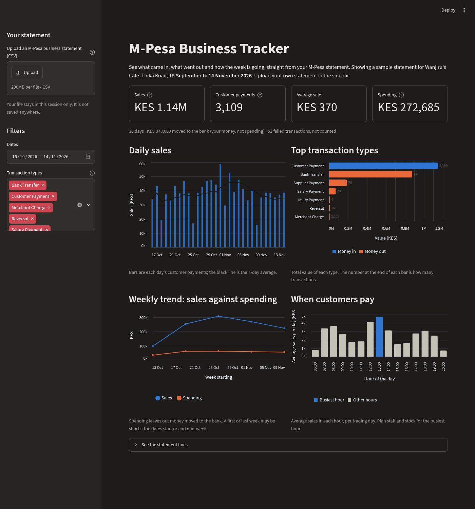

# Day 25 Exercise: M-Pesa Business Tracker

*Week 5 · Dashboards and Reporting · Drop in an M-Pesa business statement and see daily takings, where the money went, and how the week is going.*

**Live dashboard:** *link to be added after deployment*



## The brief

> Build and deploy one dashboard for a business scenario. Pick the one closest to what you can sell right now.
>
> **Option 1: M-Pesa Business Tracker.** Visualizes M-Pesa business transactions: daily revenue, top transaction types, weekly trend. Sample data in M-Pesa statement CSV format. Deploy to Streamlit Cloud. Price range: KES 15,000 to 25,000 setup.
>
> Deploy to Streamlit Cloud and paste the live URL in your README. Tag v1.0. This is a portfolio item.

I picked **Option 1**. Almost every small business in Kenya takes M-Pesa, and most owners only ever see a statement. It is the dashboard I can sell soonest, to the most people, at the lowest price.

## What the owner sees

| Part | What it does |
|---|---|
| **Upload** (sidebar) | The owner's own statement CSV. Until then, a sample statement for a fictional cafe on Thika Road loads |
| **Filters** (sidebar) | **Dates** (opens on the last 30 days) and **Transaction types** |
| **Headline numbers** | **Sales** (completed customer payments, less reversals) · **Customer payments** · **Average sale** · **Spending** (suppliers, wages, bills, M-Pesa charges). A line underneath gives the number of days, money moved to the bank, and failed transactions left out |
| **Daily sales** | One bar per day, with the 7-day average as a line |
| **Top transaction types** | Each type's total value, blue for money in and orange for money out, with the number of transactions at the end of each bar |
| **Weekly trend** | Sales against spending, week by week |
| **When customers pay** | Average sales in each hour of the day, busiest hour in blue: when to have staff and stock ready |
| **Statement lines** | The filtered lines, with a CSV download |

The date filter drives every number and chart. The type filter narrows the types chart and the statement lines, so the owner can look at, say, only supplier payments without changing the headline totals.

### Getting the money right

A statement mixes very different things, and adding them up naively gives the wrong answer:

- **Only completed transactions count.** Failed payments are listed in the caption ("52 failed transactions, not counted") but never added to sales.
- **Reversals come off sales.** A customer who paid twice and got a refund is not a sale.
- **Money moved to the owner's bank is not spending.** It is the owner's own money changing pockets. It is shown ("KES 878,000 moved to the bank") but kept out of Spending, otherwise the cafe would look like it spends more than it earns.

### What the sample statement shows

Wanjiru's Cafe, 15 September to 14 November 2026:

- **KES 2.24M in sales** from 6,087 customer payments; the average sale is **KES 369**.
- **KES 528,000 of spending:** suppliers, weekly wages, electricity tokens and merchant charges. A further **KES 1.69M** was moved to the bank.
- **1 pm is the busiest hour**, with a second peak at breakfast. Sundays are the quietest day, and month-end pay days lift sales.
- 110 failed payments and 27 reversals, all kept out of sales.

## Uploading your own statement

The tracker needs a CSV with these columns: **Completion Time, Details, Transaction Status, Paid In, Withdrawn.** **Reason Type** and **Balance** are used if they are there.

- **No Reason Type?** Each line is sorted by its Details: "Payment from…" is a customer payment, "Merchant Payment Charge" is a charge, "Salary Payment to…" is wages, "Withdraw to Bank…" is a bank transfer, "Pay Bill to…" is a supplier, and token or electricity bills are utilities. On the sample statement this sorting matches the real Reason Type on **100% of 12,436 lines**.
- **Amounts like `1,250.00`, or blanks for zero,** are read correctly; that is how Excel tends to save them.
- **The file stays in the session.** It is read into memory to draw the page and is not written to disk.
- **A wrong file** gets one sentence naming the file and the missing columns, never a traceback.

The sample's columns are **modelled on** an M-Pesa business statement export, not copied from one. A real export may name or order its columns differently, so the first step with a new client is to check their export against this list. Phone numbers in the sample are masked, and every name is made up.

## How to run it

```bash
cd Week5_DashboardsandReporting/Day25/exercise
pip install -r requirements.txt numpy

python generate_mpesa_statement.py   # optional: rebuilds data/mpesa_statement.csv
streamlit run app.py
```

## The sample data

`generate_mpesa_statement.py` writes `data/mpesa_statement.csv` with a fixed seed (2525): **12,436 lines**, newest first, as statements list them.

| Column | Example |
|---|---|
| `Receipt No.` | `TB8SFLGUUS` |
| `Completion Time` | `2026-11-14 20:57:09` |
| `Details` | `Payment from 2547******871 - FAITH B` |
| `Transaction Status` | `Completed` or `Failed` |
| `Reason Type` | `Customer Payment`, `Merchant Charge`, `Supplier Payment`, `Salary Payment`, `Utility Payment`, `Bank Transfer`, `Reversal` |
| `Paid In` / `Withdrawn` | KES |
| `Balance` | Running till balance after the line |

The running balance reconciles line by line, from an opening balance of KES 18,500 to a closing balance of KES 39,691.52, so the sample behaves like a real statement. **The data is synthetic; the business is fictional.**

## Testing

Streamlit's `AppTest`, then Chrome against the running server:

| Test | Result |
|---|---|
| Sample, last 30 days | Sales KES 1.14M, 3,109 payments, average KES 370, spending KES 272,685; KES 878,000 to the bank; 52 failed |
| Full period | Sales KES 2.24M, 6,087 payments, spending KES 527,578 |
| Only two types chosen | Types chart and table narrow; headline totals unchanged, as designed |
| Start date picked without an end date | "Now pick the end date." |
| Upload: no Reason Type, amounts with commas, blanks for zero | All seven types found; totals identical to the same lines read from the sample |
| Upload: a file with the wrong columns | *bad.csv: This file is missing the column(s): …* |

**Bugs found and fixed:**
- **Blank amounts:** in pandas 3, a blank cell stays missing after `astype(str)`, so "blank means zero" never fired and the upload was rejected. Blanks are now filled before conversion.
- **Sales card cut off:** KES 1,141,370 didn't fit, so millions now show as KES 1.14M.
- **Types chart:** sorted alphabetically for the same layered-sort reason as the project; the order is now passed explicitly.

## Pricing

**KES 18,000 setup**, inside the brief's KES 15,000 to 25,000 range:

| Work | Hours |
|---|---:|
| Get one of the client's real statement exports, map its columns and check the totals against their own records | 3 |
| Adjust the types to their business: their suppliers, rent, wage pattern | 2 |
| Deploy their own private copy and show them how to upload each week | 2 |
| Fixes in the first two weeks | 3 |
| **Total** | **10** |

10 hours at KES 1,800/hour. I would quote the low end, KES 15,000, for a business whose statement matches the sample's columns exactly, and the top, KES 25,000, for one with several tills or paybills to combine. An optional **KES 1,500 a month** covers small changes and fixes when Safaricom changes the export.

The value to the owner: an hour or two a week less spent reading statements, and an answer to "where did the money go?" the moment they ask it.

## Files

| File | What it is |
|---|---|
| [`app.py`](app.py) | The Streamlit tracker |
| [`generate_mpesa_statement.py`](generate_mpesa_statement.py) | Writes the sample statement, fixed seed 2525 |
| [`data/mpesa_statement.csv`](data/mpesa_statement.csv) | Sample statement, committed so the deployed app can read it |
| [`requirements.txt`](requirements.txt) | Streamlit, pandas and Altair, pinned to the versions I tested with |
| [`screenshots/dashboard.png`](screenshots/dashboard.png) | The tracker on a laptop |

## What I practised

- Picking the option closest to what I can sell, and designing for a small-business owner
- Reading a statement-style export: completed vs failed, reversals, own-money transfers vs real spending
- Sorting statement lines by their description when the export has no type column, and measuring how well it works (100% on the sample)
- Cleaning money columns written the Excel way (commas, blanks), and a pandas 3 change that broke it
- `st.file_uploader` with the sample as the fallback, widget keys tied to the file, and plain-language errors
- `st.date_input` ranges and `st.multiselect` filters, with a clear rule for what each filter changes
- Four Altair charts: daily bars with a 7-day average, value by type with direction colour, weekly sales against spending, and the busiest hour
- Formatting headline numbers so they fit (KES 1.14M)
- Pinning `requirements.txt` and committing the sample data, so the app deploys to Streamlit Cloud as it runs locally

## Requirements

```
pip install -r requirements.txt
```

Python 3.11 or later (pandas 3 needs it). Built and tested with Python 3.14 and Streamlit 1.67.
