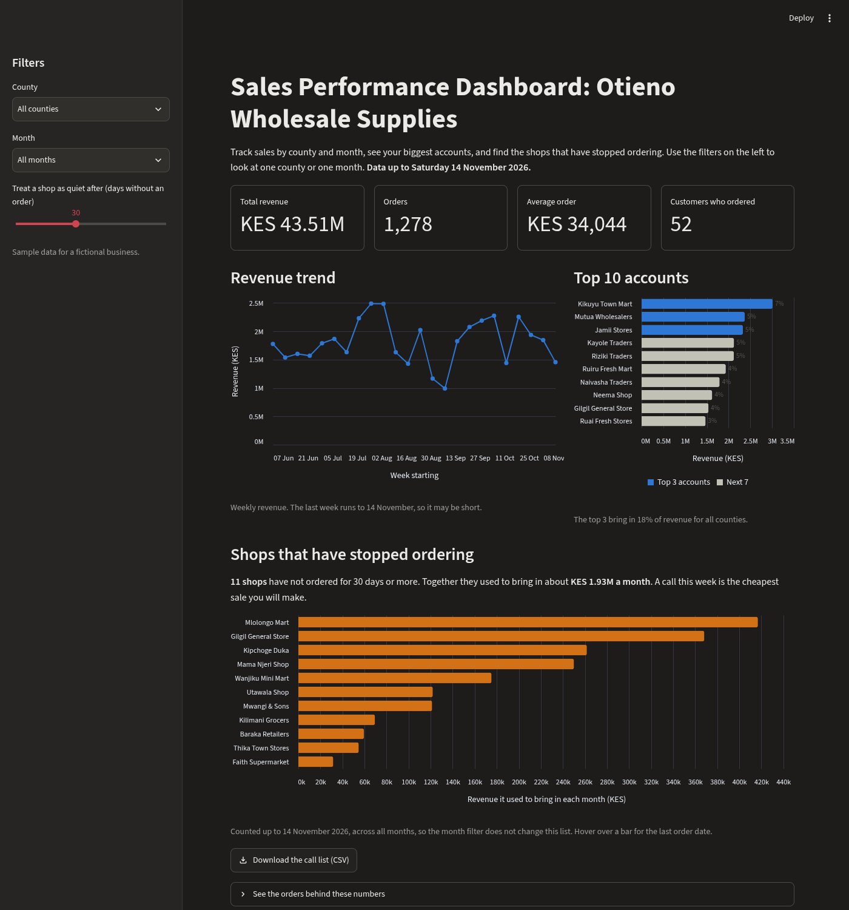

# Day 25 Project: Sales Performance Dashboard, Otieno Wholesale Supplies

*Week 5 · Dashboards and Reporting · A deployed Streamlit dashboard for a Nairobi wholesaler: sales by county and month, top accounts, and the shops that have stopped ordering.*

**Live dashboard:** *link to be added after deployment*



## The brief

> Build a client-ready interactive dashboard, designed for a non-technical user, and deploy it. Choose a dataset relevant to a business type (Option A: distributor sales, orders by county, product, customer and date; good for revenue trends, top accounts and dormant customer analysis). Build a Streamlit dashboard with at least two filters and three charts, write a short description the client sees first, and deploy it to Streamlit Cloud.

I chose **Option A, distributor sales**. It is the business type I can most easily sell to: every wholesaler in Nairobi has this data in a spreadsheet or a POS export.

## What the owner sees

The page opens with one paragraph: what the dashboard is for, how to use the filters, and **"Data up to Saturday 14 November 2026"**, so the owner always knows how fresh it is.

| Part | What it does |
|---|---|
| **Filters** (sidebar) | **County** (all, or one of five) and **Month** (all, or one month, newest first). A third control sets how many days without an order makes a shop "quiet": 14, 21, 30, 45, 60 or 90 days, 30 by default |
| **Headline numbers** | Total revenue · orders · average order · customers who ordered. When one finished month is chosen, each shows the change on the month before, for example **+24% on September** for October. A change under half a percent shows as a grey "No change" |
| **Revenue trend** | Weekly revenue for all months; daily bars when one month is chosen |
| **Top 10 accounts** | Largest first, top three in blue, each labelled with its share of revenue |
| **Shops that have stopped ordering** | Every shop with no order in the chosen number of days, ranked by the revenue it used to bring in each month. One sentence on top gives the total at risk. **Download the call list** saves it as a CSV for whoever makes the calls |
| **The orders behind the numbers** | The raw order lines, folded away in an expander |

### What the sample data shows

- **KES 43.5M** over 1,278 orders from 52 shops, 1 June to 14 November 2026.
- **11 shops have not ordered for 30 days or more.** Together they used to bring in about **KES 1.93M a month**. The two biggest are Mlolongo Mart (about KES 417,000 a month, quiet since 24 September) and Gilgil General Store (about KES 368,000, quiet since 8 October). Winning back the top two alone is worth more than most single accounts.
- **October was up 24% on September.** Weekly revenue dips in early September, when shops spend on school fees instead of stock.
- **No single account dominates:** the top three are 18% of revenue, so the business's risk is lots of shops drifting away, not one big loss. That is why the quiet-shops list sits on the front page.

## Design choices for a non-technical owner

- **The description comes first** and says what the page is for and how fresh the data is, before any number.
- **Revenue at risk is shown per month,** in what each shop *used to* bring in, so the owner sees what a phone call is worth. A shop's monthly figure is its revenue divided by the months between its first and last order, with at least one month counted, so a shop with one order isn't shown as a huge monthly loss.
- **The quiet-shops list ignores the month filter,** and the caption says so. "Has this shop stopped ordering?" is always about today, not about the month being viewed.
- **November is marked as month to date.** Comparing 14 days of November with 31 days of October would show a false drop, so there is no comparison until the month is complete.
- **Average order is per order,** not per line. One order of three products counts once.
- **Emphasis colour:** blue for the point of each chart (the top three accounts), grey for context, orange only for the shops at risk.
- **Plain errors:** a missing file, missing column or unreadable number gives one sentence, not a traceback.

## How to run it

```bash
cd Week5_DashboardsandReporting/Day25/project
pip install -r requirements.txt numpy

python generate_sales_data.py    # optional: rebuilds data/sales_data.csv
streamlit run app.py
```

The sample CSV is committed because the deployed app reads it. `numpy` is only needed by the generator, so it is not in `requirements.txt`.

## The data

`generate_sales_data.py` writes `data/sales_data.csv` with a fixed seed (25): **2,584 order lines** in **1,278 orders**. Trading days run Monday to Saturday, 1 June to 14 November 2026.

| Column | Example | Meaning |
|---|---|---|
| `order_id` | `ORD-100421` | One order; an order can have up to three product lines |
| `date` | `2026-10-08` | Order date |
| `customer` | `Gilgil General Store` | The shop |
| `county` | `Kajiado` | Nairobi, Kiambu, Machakos, Kajiado or Nakuru |
| `product` | `Rice 25kg bag` | One of eight staples |
| `quantity` | `4` | Units on the line |
| `price` | `4290` | KES per unit; revenue is `quantity × price`, as in the lesson |

Built into the data: gentle growth with prices rising about 4% over the period, a back-to-school dip, ten shops that stop ordering between August and October (three of them big accounts), and four shops that join part-way through. **The data is synthetic; the business is fictional.**

## Testing

I tested it with Streamlit's `AppTest` and in Chrome against the running server:

| View | Result |
|---|---|
| All counties, all months | KES 43.51M, 1,278 orders, average order KES 34,044, 52 customers; 11 quiet shops, about KES 1.93M a month |
| October | KES 8.85M, **+24% on September**; average order shows "No change on September" (under half a percent) |
| November | Marked as month to date, no comparison |
| Nakuru, November | One shop ordered, so the caption says "Only 1 shop ordered for Nakuru in November 2026" instead of a top-three share |
| Quiet after 14 days | 19 shops, about KES 3.09M a month |
| Quiet after 90 days, Nakuru | None left, so the page says every shop in Nakuru has ordered recently |

**Bugs found in the browser and fixed:**
- The top-10 chart was sorting accounts alphabetically. Adding the text labels as a second chart layer drops Altair's "sort by value"; the chart now gets the order explicitly.
- The quiet-days slider stepped in sevens from 14, so its default of 30 couldn't be selected (it sat at 28). It is now a choice of 14, 21, 30, 45, 60 or 90 days.

## Files

| File | What it is |
|---|---|
| [`app.py`](app.py) | The Streamlit dashboard |
| [`generate_sales_data.py`](generate_sales_data.py) | Writes the sample data, fixed seed 25 |
| [`data/sales_data.csv`](data/sales_data.csv) | Sample orders, committed so the deployed app can read them |
| [`requirements.txt`](requirements.txt) | Streamlit, pandas and Altair, pinned to the versions I tested with |
| [`screenshots/dashboard.png`](screenshots/dashboard.png) | The dashboard on a laptop |

## Portfolio entry

> **Sales Performance Dashboard: Otieno Wholesale Supplies**
>
> An interactive Streamlit dashboard for tracking wholesale sales by county and month. Built on distributor data from Nairobi. Features county and month filters, KPI cards with month-on-month change, a revenue trend, the top ten accounts, and a list of shops that have stopped ordering, ranked by the monthly revenue at risk, with a downloadable call list.
>
> Live dashboard: *link to be added after deployment* · GitHub: [Week5_DashboardsandReporting/Day25/project](https://github.com/st4ns3c/Track_B_Data_Analyst/tree/main/Week5_DashboardsandReporting/Day25/project)

## What I practised

- Choosing a business dataset by what I can sell, and designing the page around the owner's questions
- A wide Streamlit layout with sidebar filters (`selectbox`, `select_slider`), KPI cards in `st.columns`, and charts side by side
- Month-on-month deltas on `st.metric`, switched off for a month that isn't finished
- Altair charts: a weekly line or daily bars depending on the filter, a ranked bar chart with labels and emphasis colour, and a ranked at-risk chart with tooltips
- Dormant-customer analysis: days since last order, and the monthly revenue each quiet shop used to bring in
- A downloadable call list with `st.download_button`
- `st.cache_data`, and paths built from `Path(__file__)` so the app runs the same locally and on Streamlit Cloud
- Pinning `requirements.txt` for deployment
- Catching layout bugs only a real browser shows: the layered sort and the slider step

## Requirements

```
pip install -r requirements.txt
```

Python 3.11 or later (pandas 3 needs it). Built and tested with Python 3.14 and Streamlit 1.67.
